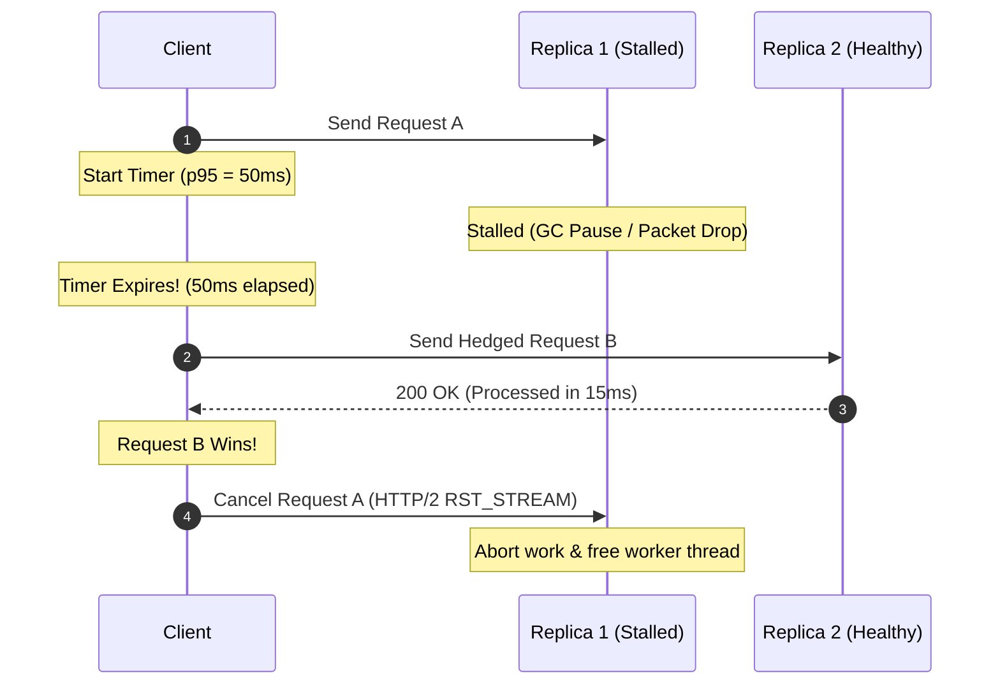

# Hedged Requests: Masking Distributed Timeout and Latency Exceptions

---

### 1. 💡 The "Big Picture" (Plain English)

#### What is this in simple terms?
In a distributed system, waiting for a service to throw a hard timeout exception can take seconds—destroying user experience. A **Hedged Request** (also known as speculative retry) is a proactive exception mitigation pattern: instead of waiting for a slow or failing request to fully time out and throw an error, your client sends a duplicate "speculative" copy of the request to another replica after a short delay (e.g., the 95th percentile latency). Whichever replica responds first wins; the other request is immediately canceled.

#### Real-World Analogy
Imagine you are at an airport trying to hail a cab. You call Cab Company A. If they don't arrive in 5 minutes (the usual wait time), you don't wait the full 45 minutes for them to officially cancel on you. Instead, you call Cab Company B while keeping Company A on standby. Whichever driver pulls up to the curb first gets your business; you immediately call the other driver to cancel the ride.

#### Why should I care? What problem does it solve for me today?
Distributed architectures are plagued by **tail-latency anomalies** and **silent transient stalls** (such as stop-the-world JVM garbage collection pauses, noisy-neighbor hypervisor steals, or transient TCP packet loss). 
* Without Hedged Requests: A client waits for the entire timeout duration (e.g., 2,000ms), receives a `GatewayTimeoutException`, retries, and fails the user's SLA.
* With Hedged Requests: You mask the stall. If a node fails to answer within the expected 50ms window, a secondary node answers in 55ms. The user experiences zero exceptions and virtually no delay.

---

### 2. 🛠️ How it Works (Step-by-Step)

1. **Send Initial Request:** The client sends Request A to Replica 1 and starts a timer set to the downstream service's $P_{95}$ latency threshold.
2. **Evaluate Deadline:** 
   * If Replica 1 responds before the timer fires, the client returns the response and terminates the flow.
   * If the timer expires before Replica 1 responds, the client does **not** abort Request A.
3. **Dispatch Hedged Copy:** The client sends an identical Request B to Replica 2.
4. **First-Response Wins:** Whichever replica returns a successful response first fulfills the client's call.
5. **Cancel the Loser:** The client immediately sends an abort signal (e.g., an HTTP/2 `RST_STREAM` or gRPC cancellation) to the slower/stalled replica to prevent resource waste.

#### Code Snippet (Go with Context Cancellation)

```go
package main

import (
	"context"
	"errors"
	"net/http"
	"time"
)

type Result struct {
	Response *http.Response
	Err      error
}

// ExecHedgedQuery dispatches a primary request and hedges with a secondary replica
// if the primary does not respond within the p95 latency window.
func ExecHedgedQuery(parentCtx context.Context, replicaURLs []string, p95Threshold time.Duration) (*http.Response, error) {
	if len(replicaURLs) < 2 {
		return nil, errors.New("at least two replicas required for hedging")
	}

	// Channel to receive the first successful result
	resultChan := make(chan Result, 2)
	
	// Master cancellation context to kill the loser
	ctx, cancel := context.WithCancel(parentCtx)
	defer cancel() // Ensure all spawned requests are cleaned up on return

	sendReq := func(url string) {
		req, err := http.NewRequestWithContext(ctx, http.MethodGet, url, nil)
		if err != nil {
			resultChan <- Result{Err: err}
			return
		}
		// Execute request (using standard HTTP client)
		resp, err := http.DefaultClient.Do(req)
		resultChan <- Result{Response: resp, Err: err}
	}

	// 1. Fire Primary Request to Replica 1
	go sendReq(replicaURLs[0])

	// 2. Wait for either a response or the p95 hedge timer
	timer := time.NewTimer(p95Threshold)
	defer timer.Stop()

	select {
	case res := <-resultChan:
		if res.Err == nil && res.Response.StatusCode == http.StatusOK {
			return res.Response, nil
		}
		// If replica 1 failed immediately with an exception, immediately try replica 2
	case <-timer.C:
		// p95 exceeded! Fire speculative Hedged Request to Replica 2
		go sendReq(replicaURLs[1])
	case <-parentCtx.Done():
		return nil, parentCtx.Err()
	}

	// 3. Await the first winner between the two concurrent executions
	for i := 0; i < 2; i++ {
		select {
		case res := <-resultChan:
			if res.Err == nil && res.Response.StatusCode == http.StatusOK {
				cancel() // Step 5: Cancel the losing request immediately
				return res.Response, nil
			}
		case <-parentCtx.Done():
			return nil, parentCtx.Err()
		}
	}

	return nil, errors.New("all hedged replicas failed to respond successfully")
}
```

#### Request Flow Architecture



---

### 3. 🧠 The "Deep Dive" (For the Interview)

#### The Internal Mechanics
* **Transport-Level Cooperative Cancellation:** In modern RPC frameworks (gRPC/HTTP/2), canceling the context doesn’t just ignore the response in memory; it transmits an `RST_STREAM` frame across the multiplexed TCP socket. The remote server’s event loop receives this frame, triggers an interruption on the servicing thread/goroutine, and prevents wasted CPU cycles and DB queries.
* **Latency Distribution Skew:** In large microservice call trees, $P_{99}$ service latencies compound exponentially. If an operation requires 100 parallel RPCs, and each service has a 1% chance of a 1-second timeout stall, the overall request has a $1 - (0.99)^{100} \approx 63.4\%$ chance of stalling. By hedging at the $P_{95}$ boundary, tail latency collapses to the median of the secondary node.

#### Trade-offs & Operational Realities

| Dimension | Benefit | Risk / Trade-off |
| :--- | :--- | :--- |
| **Availability & Latency** | Eliminates tail timeouts; masks transient hardware hiccups. | Increases total request traffic downstream by 1% to 5%. |
| **System Load** | Resilient against silent stalls (e.g., hypervisor jitter). | **Retry Amplification Risk:** If the stall is caused by global database lock contention, hedging doubles system load and triggers cascading failure. |
| **Implementation Complexity** | Zero user-facing errors during single-replica degradation. | Requires strict **idempotency** across all target endpoints; unsafe for non-idempotent mutations. |

---

#### Interviewer Probes (Tricky Edge Cases)

##### 1. "If you deploy Hedged Requests across all microservices, won't you cause a self-inflicted Denial of Service (DoS) during an outage?"
> **Strong Answer:**  
> Yes, uncapped hedging during an actual systemic outage causes a catastrophic traffic amplification storm. To prevent this, three controls are non-negotiable:
> 1. **Hedging Budget:** Cap speculative requests using a token bucket (e.g., hedged calls cannot exceed 2% to 5% of total outbound requests across the client instance).
> 2. **Adaptive Thresholds:** Dynamically calculate the hedge trigger using a sliding window of the $P_{95}$ or $P_{99}$ latency, rather than a hardcoded static timeout.
> 3. **Circuit Breaker Integration:** If downstream error rates exceed 5%, automatically disable speculative hedging entirely to avoid kicking a struggling dependency while it is down.

##### 2. "Why can't you use Hedged Requests for POST or PATCH operations?"
> **Strong Answer:**  
> Hedging sends duplicate requests **in parallel** while the first request is still in-flight. If the operation is not idempotent, both replicas may process the mutation concurrently, leading to duplicate records, race conditions, or state corruption. While you *could* theoretically enforce mutual exclusion using distributed locking or idempotency keys, the distributed lock acquisition latency completely negates the sub-millisecond tail-latency advantages of hedging. Hedged requests are strictly reserved for read-only or safe, naturally idempotent operations.

##### 3. "What happens on the server side when the client cancels the losing hedged request?"
> **Strong Answer:**  
> It depends on whether the server runtime respects cooperative cancellation. If using standard blocking I/O (like an unconfigured legacy Spring/Tomcat servlet), the server thread continues processing the query to completion, throwing away the output only when it fails to write back to the broken socket. To make hedging work efficiently at scale, the backend must use reactive pipelines or explicitly propagate cancellations to the storage layer (e.g., passing Go's `context.Context` to the database driver so the database cancels the query via `pg_cancel_backend` or its equivalent).

---

### 4. ✅ Summary Cheat Sheet

* **Mask, Don't Wait:** Instead of waiting for a 2-second timeout exception to fail your SLA, fire a speculative duplicate request at the $P_{95}$ latency mark (e.g., 50ms).
* **First Arrival Wins:** Accept the fastest response and cancel the slower request immediately via HTTP/2 stream resets or gRPC cancellations.
* **Strict Constraints Required:** Only apply this pattern to **idempotent** operations, and enforce a **hedging budget** (maximum 2–5% additional traffic) to prevent self-inflicted retry storms.

> 🏆 **Golden Rule:** *Never let a single slow node dictate your user's experience—speculate early, cancel the loser, and never hedge without a strict traffic budget.*