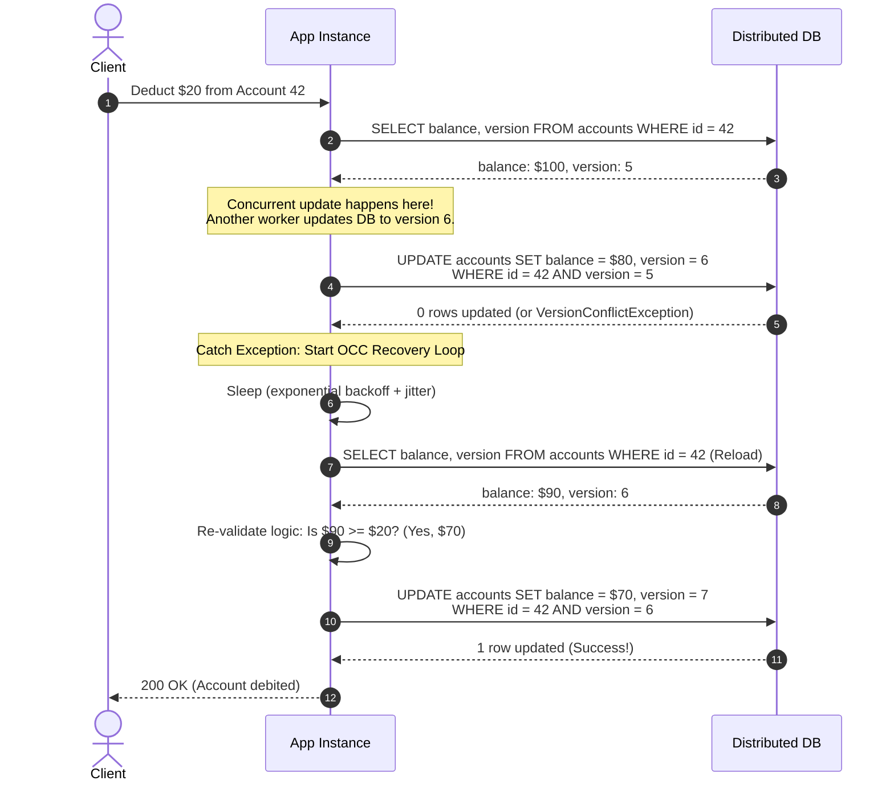

# Distributed Optimistic Concurrency Control (OCC): Handling Version Conflict Exceptions

---

### 1. 💡 The "Big Picture" (Plain English)

#### What is this in simple terms?
In a distributed system, multiple machines often try to update the exact same piece of data at the same time. Instead of using heavy, slow locks to stop everyone else from working, **Optimistic Concurrency Control (OCC)** assumes conflicts are rare. Every service reads the data along with a **version number**. When saving, the service tells the database: *"Only save this if the version number is still what it was when I read it."* 

If another service updated the data first, the database rejects the write and throws a **Version Conflict Exception** (e.g., HTTP `412 Precondition Failed` or `ConditionalCheckFailedException`). The challenge—and the strategy—is how your application gracefully handles that rejection without crashing, corrupting state, or dropping user updates.

```
       Service A (Reads v1) ───[Calculates]───► Writes v2 (Success!)
                                                   │
Database State: [Balance: $100 | Version: 1] ──────┴─► [Balance: $150 | Version: 2]
                                                           ▲
       Service B (Reads v1) ───[Calculates]───► Writes v2 ─┘ 
                                                💥 EXCEPTION: Version mismatch! 
                                                   (Expected v1, found v2)
```

#### Real-World Analogy
Imagine a shared document printed on paper. You and a coworker both take a photocopy of **Revision 1** back to your desks to edit it. 
* Your coworker finishes first, marks their update as **Revision 2**, and replaces the master copy in the filing cabinet.
* Ten minutes later, you walk up with your updates marked as **Revision 2**. 
* The office manager stops you: *"Sorry! Someone already filed Revision 2. Your paper is out of date."*
* You don't throw your work in the trash or punch the manager. Instead, you grab the **new Revision 2**, copy your edits onto it (if they still make sense), update your paper to **Revision 3**, and file it.

#### Why Should I Care?
Pessimistic locking (holding a database lock while your microservice processes logic) destroys throughput, causes distributed deadlocks, and can freeze your database if a service crashes mid-transaction. Distributed OCC allows maximum read/write concurrency. However, without an automated **OCC Exception Handling Strategy**, these version conflicts bubble up to end-users as random errors, checkout failures, or silent data overwrites.

---

### 2. 🛠️ How it Works (Step-by-Step)

Handling an OCC conflict exception requires a deterministic **Read-Modify-Write-Retry (RMWR)** cycle paired with business validation:

1. **Fetch & Tag:** Read the entity along with its current state and version tag (`version`, `timestamp`, or `ETag`).
2. **Apply Domain Logic:** Compute the new state in-memory (e.g., deduct balance, append items).
3. **Conditional Commit:** Execute an atomic Compare-And-Swap (CAS) write condition (e.g., `WHERE id = :id AND version = :expectedVersion`).
4. **Catch the Conflict:** If the write returns zero affected rows or throws a conflict exception, do not crash. Catch the specific conflict error.
5. **Reload, Re-evaluate, & Backoff:** Fetch the fresh state from the database. Re-run business rules (e.g., does the user *still* have enough balance?). Apply exponential backoff with jitter to avoid collisions, then attempt the write again up to a bounded limit.

#### The Flow



#### Production-Grade Code Snippet (Python)

```python
import time
import random
from typing import Optional

class OptimisticLockException(Exception):
    """Raised when an atomic conditional update fails due to version mismatch."""
    pass

class AccountRepository:
    def get(self, account_id: str) -> dict:
        # Mock database fetch: returns {'id': str, 'balance': int, 'version': int}
        pass

    def update_balance_conditional(
        self, account_id: str, new_balance: int, expected_version: int
    ) -> bool:
        """
        Executes:
        UPDATE accounts 
        SET balance = :new_balance, version = version + 1 
        WHERE id = :account_id AND version = :expected_version;
        """
        # Returns True if 1 row updated, False if 0 rows updated (version changed)
        pass


class AccountService:
    def __init__(self, repo: AccountRepository):
        self.repo = repo
        self.max_retries = 3
        self.base_delay_ms = 50

    def debit_account(self, account_id: str, amount: int) -> dict:
        """
        Debits an account using an automated OCC retry-and-merge strategy.
        """
        for attempt in range(1, self.max_retries + 1):
            # 1. Fetch current state and version tag
            account = self.repo.get(account_id)
            if not account:
                raise ValueError("Account not found")

            # 2. In-Memory Domain Validation
            if account["balance"] < amount:
                raise ValueError("Insufficient funds")  # Permanent business failure

            new_balance = account["balance"] - amount
            expected_version = account["version"]

            # 3. Attempt Conditional CAS write
            success = self.repo.update_balance_conditional(
                account_id=account_id,
                new_balance=new_balance,
                expected_version=expected_version
            )

            if success:
                return {"account_id": account_id, "balance": new_balance, "version": expected_version + 1}

            # 4. Handle OCC Conflict Exception
            # The record changed beneath us. Do not give up immediately.
            if attempt == self.max_retries:
                raise OptimisticLockException(
                    f"Exceeded max retries ({self.max_retries}) updating account {account_id} due to concurrent conflicts."
                )

            # 5. Exponential Backoff with Decorrelated Jitter to prevent lockstep retries
            sleep_time = (self.base_delay_ms * (2 ** (attempt - 1)) + random.uniform(10, 50)) / 1000.0
            time.sleep(sleep_time)
            
            # Loop restarts: Fresh state will be read, re-validated, and re-applied.
```

---

### 3. 🧠 The "Deep Dive" (For the Interview)

#### The Technical Internals
Under the hood, OCC delegates conflict detection to the storage engine's atomic **Compare-And-Swap (CAS)** primitive:
* **Relational DBs (PostgreSQL, MySQL):** MVCC uses row visibility tuples (e.g., `xmin`/`xmax` in Postgres). An OCC write evaluates the `WHERE version = x` predicate under a row-level write lock. Even without an explicit `SELECT FOR UPDATE`, the actual `UPDATE` statement acquires a transient write lock on the matching row index. If the row version has shifted, the predicate matches 0 rows.
* **NoSQL Engines (DynamoDB, Cosmos DB):** DynamoDB utilizes **Conditional Expressions** (`attribute_exists(v) AND v = :expected`). The storage partition leader resolves writes sequentially via its Raft/Paxos log; if the condition evaluates to false at the head of the log, the leader drops the write and emits a `TransactionCanceledException` / `ConditionalCheckFailedException`.
* **Hardware/Memory Layer:** In distributed in-memory grids (e.g., Redis via `WATCH/MULTI` or Cassandra lightweight transactions via Paxos), OCC utilizes the underlying CPU’s atomic `LOCK CMPXCHG` instruction on the primary node to safely evaluate version pointers.

#### Architectural Trade-offs
| Strategy | Pros | Cons |
| :--- | :--- | :--- |
| **Optimistic (OCC)** | Zero idle lock time; high throughput for read-heavy workloads; prevents distributed deadlocks. | Extreme write amplification and latency spikes under high contention; wastes CPU/network cycles re-running logic. |
| **Pessimistic Locking** (`SELECT FOR UPDATE` / Mutex) | Guaranteed success on the first attempt once lock is acquired; predictable execution order under high contention. | Risk of distributed deadlocks; connection pool exhaustion; system grinds to a halt if lock holder crashes. |
| **Commutative Merging** (CRDTs / Semantic Deltas) | Eliminates conflict retries entirely (e.g., `SET balance = balance - 20`). | Cannot validate complex business invariants (e.g., "balance must never drop below $0") prior to write execution. |

#### Interviewer Probes (Tricky Edge Cases)

##### 1. "What happens if your OCC retry loop runs logic that has external side effects (e.g., sending an email or charging a payment gateway)?"
**The Candidate Answer:**
> *"Side effects must never execute inside an OCC retry loop. Because an OCC transaction can fail and repeat multiple times, any side effect inside the loop will execute multiple times (violating at-most-once/at-least-once semantics). You must separate the transaction into two phases: execute the OCC mutation first using pure, idempotent state transformations. Only after the conditional write succeeds and the version increment is durably committed should you dispatch downstream side effects, ideally using the **Transactional Outbox Pattern** to ensure atomicity."*

##### 2. "How do you protect your system against 'Live-Lock' during an OCC conflict storm?"
**The Candidate Answer:**
> *"Live-lock happens when multiple threads continuously conflict, reload at the same time, calculate at the same time, and fail again in lockstep—burning CPU without making forward progress. To solve this:
> 1. Use **Full Jitter** on exponential backoff to desynchronize retry intervals.
> 2. Implement **Adaptive Shedding/Fallback**: If conflict frequency for a specific partition key exceeds a threshold (e.g., 5% of writes), fall back dynamically to a serialized queue (e.g., routing updates through a single Kafka partition or a localized actor).*

##### 3. "Can OCC suffer from the classic 'ABA Problem', and how do modern distributed datastores prevent it?"
**The Candidate Answer:**
> *"The ABA problem occurs if state changes from value A to B, and then back to A. If your OCC check relies merely on state equality or a looping timestamp, the engine might think nothing changed and apply a stale update. Distributed databases mitigate this by using **strictly monotonic counters** (64-bit integer version numbers that only increment), **UUID v4 generation tokens**, or **Lamport/Hybrid Logical Clocks (HLC)** rather than system wall-clock times, ensuring every modification creates a globally unique, forward-moving vector."*

---

### 4. ✅ Summary Cheat Sheet

#### 3 Key Takeaways
1. **OCC is a "Try-Detect-Recover" Strategy:** Never hold locks across network calls. Read the version tag, do the work, and use an atomic conditional expression (`WHERE version = X`) at the storage layer to catch collisions.
2. **Business Rules Must Be Re-Validated on Retry:** When an OCC exception triggers a reload, you cannot simply re-attempt the previous write payload. You must re-run your domain checks against the *fresh* state (e.g., verifying stock availability or credit limits).
3. **High Contention Kills OCC:** OCC works brilliantly when collision probability is low (< 2-3%). Under high write contention on a single key, OCC cascades into CPU thrashing; switch to **partitioned event streams** or **pessimistic queueing** instead.

#### 1 Golden Rule to Remember
> *"Keep all side effects outside the loop, ensure your state mutation is purely re-computable, and always add randomized jitter when handling an OCC conflict."*