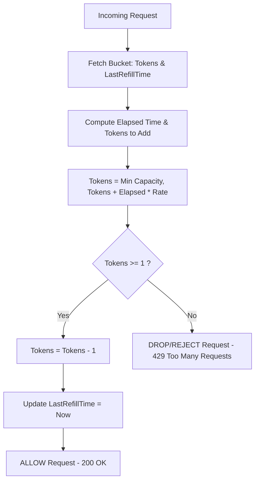

# Resilient API Guardrails: Token Bucket vs. Leaky Bucket Under High Load

---

### 1. 💡 The "Big Picture" (Plain English)

#### What is this in simple terms?
A **rate limiter** acts as a traffic cop for your application. It controls how many requests a user or client can send to your API within a given window of time. If a user sends too many requests too quickly, the rate limiter steps in and says: *"Slow down—try again later"* (HTTP status code `429: Too Many Requests`).

#### Real-World Analogy
* **The Token Bucket (Arcade Tokens):** 
  Imagine an arcade prize counter that dispenses 1 game token every minute into a small bucket that holds a maximum of 5 tokens. 
  * If you walk away for 10 minutes, the bucket fills up to 5 and stops. 
  * You can come back and spend all 5 tokens instantly in a rapid burst. 
  * Once the bucket is empty, you must wait for the next token to drop before you can play again.
* **The Leaky Bucket (Water Funnel):** 
  Imagine a funnel with a narrow hole at the bottom. 
  * Clients pour water (requests) into the top at whatever speed they want—sometimes a trickle, sometimes an entire glass at once. 
  * The water drains out of the bottom to your database at a **strictly constant, predictable drip**. 
  * If someone pours water faster than the funnel can hold, the funnel overflows, and the excess water spills onto the floor (dropped requests).

```
   TOKEN BUCKET (Allows Bursts)             LEAKY BUCKET (Smooths Traffic)
  ┌─────────────────────────────┐        ┌─────────────────────────────┐
  │  Tokens drop in at rate R   │        │  Requests enter (bursty)    │
  │            ▼                │        │            ▼                │
  │     [ ●  ●  ●  ● ] (Max C)  │        │   \  req req req req  /     │
  │            ▼                │        │    \  req req req    /      │
  │ Requests take token & pass  │        │     \   req req     /       │
  │  (Burst allowed if tokens)  │        │      \   req       /        │
  └─────────────────────────────┘        └───────┬───────────┬─────────┘
                                                 │  Drip...  │ (Constant rate)
                                                 ▼           ▼
```

#### Why should I care?
Without rate limiting:
1. **Outages from Traffic Spikes:** A rogue customer script or a DDOS attack can crash your databases.
2. **Cascading Failures:** If your payment gateway handles only 100 requests/sec, uncontrolled upstream traffic will overwhelm it and crash dependent systems.
3. **Noisy Neighbor Problem:** In a multi-tenant cloud application, one heavy user can consume all server resources, degrading performance for everyone else.

---

### 2. 🛠️ How it Works (Step-by-Step)

#### Step-by-Step Execution: Token Bucket (Lazy Refill Pattern)
Beginners often think: *"I need a background thread running every second to add tokens."* **Never do this in production.** If you have 10 million users, you would need 10 million timers. Instead, calculate tokens **on-demand** whenever a request arrives.

1. **Request Arrives:** Read the user's bucket state: `current_tokens` and `last_refill_timestamp`.
2. **Calculate New Tokens:** Determine how much time elapsed since the last request:
   $$\text{tokens\_to\_add} = (\text{now} - \text{last\_refill\_timestamp}) \times \text{refill\_rate}$$
3. **Update Bucket:** Add the new tokens to `current_tokens` (capped at max capacity).
4. **Evaluate:**
   * If `current_tokens >= 1`: Deduct 1 token, update `last_refill_timestamp = now`, and **allow** the request.
   * If `current_tokens < 1`: Deny the request (HTTP 429).



#### Clean Code Implementation (Thread-Safe Token Bucket)

```python
import time
import threading

class TokenBucketRateLimiter:
    def __init__(self, capacity: int, refill_rate_per_sec: float):
        self.capacity = capacity
        self.refill_rate = refill_rate_per_sec
        self.current_tokens = float(capacity)
        self.last_refill_time = time.monotonic()
        self.lock = threading.Lock()

    def allow_request(self, tokens_needed: int = 1) -> bool:
        with self.lock:
            now = time.monotonic()
            elapsed = now - self.last_refill_time
            
            # Lazy calculation: calculate token refill on-the-fly
            tokens_to_add = elapsed * self.refill_rate
            self.current_tokens = min(float(self.capacity), self.current_tokens + tokens_to_add)
            self.last_refill_time = now

            # Check capacity
            if self.current_tokens >= tokens_needed:
                self.current_tokens -= tokens_needed
                return True
            
            return False

# Quick test
limiter = TokenBucketRateLimiter(capacity=3, refill_rate_per_sec=1.0)
for i in range(5):
    allowed = limiter.allow_request()
    print(f"Request {i+1}: {'Allowed' if allowed else 'Blocked'}")
# Requests 1, 2, 3 -> Allowed (burst)
# Requests 4, 5    -> Blocked (bucket empty)
```

---

### 3. 🧠 The "Deep Dive" (For the Interview)

#### Architectural Differences: Token Bucket vs. Leaky Bucket

| Dimension | Token Bucket | Leaky Bucket |
| :--- | :--- | :--- |
| **Burst Handling** | **Allows bursts** up to bucket capacity $C$. | **Flattens bursts**; strictly constant outflow rate. |
| **Memory Footprint** | Extremely low ($O(1)$ space: 2 numbers—tokens & timestamp). | Medium-to-High if backed by an actual queue ($O(N)$ memory). |
| **Outflow Pattern** | Variable (matches request spikes until empty). | Uniform, smooth output rate. |
| **Primary Use Case** | General API Gateways (user-facing, bursty web apps). | Ingestion pipelines, feeding sensitive downstream batch DBs. |

#### Distributed State & Race Conditions (The "Redis Trap")
In a distributed system, rate limit state is stored in an in-memory cache like **Redis**. A naive implementation does this:
1. `GET user:123:tokens`
2. Calculate new tokens in the web server memory.
3. `SET user:123:tokens`

**The Failure:** Under high concurrency, two requests arrive at different server instances simultaneously. Both read `tokens = 1`, both allow the request, and both decrement to `0`. You just permitted double the allowed traffic (Read-Modify-Write Race Condition).

**The Solution:** Use a **Redis Lua Script**. Redis executes Lua scripts atomically in a single thread, preventing any competing read/write operations from interleaving.

```lua
-- Atomic Token Bucket in Redis Lua (keys[1]: bucket_key, args: capacity, rate, now, requested)
local key = KEYS[1]
local capacity = tonumber(ARGV[1])
local refill_rate = tonumber(ARGV[2])
local now = tonumber(ARGV[3])
local requested = tonumber(ARGV[4])

local data = redis.call("HMGET", key, "tokens", "last_updated")
local tokens = tonumber(data[1])
local last_updated = tonumber(data[2])

if tokens == nil then
    tokens = capacity
    last_updated = now
else
    local elapsed = math.max(0, now - last_updated)
    tokens = math.min(capacity, tokens + (elapsed * refill_rate))
end

if tokens >= requested then
    tokens = tokens - requested
    redis.call("HMSET", key, "tokens", tokens, "last_updated", now)
    redis.call("EXPIRE", key, math.ceil(capacity / refill_rate))
    return 1 -- Allowed
else
    return 0 -- Denied
end
```

#### Interviewer Probes & Counter-Strategies

##### Probe 1: "Our Redis instance has become our latency bottleneck because every API call makes a network round-trip to execute this Lua script. How do you scale this?"
* **Answer:** **Token Batching (Local Aggregation).** 
  Instead of hitting Redis for every single request, the API server reserves a batch of tokens locally (e.g., claiming 20 tokens at once using a single Redis call). 
  The server fulfills the next 20 incoming requests out of local memory. If the local token supply drops below a threshold, it asynchronously requests another batch. 
  *Trade-off:* If an API server crashes, the reserved tokens are temporarily lost (a minor over-throttling penalty in exchange for a 10x-20x drop in Redis load).

##### Probe 2: "How can you implement a Leaky Bucket *without* maintaining an actual in-memory FIFO queue that eats up RAM?"
* **Answer:** Use the **Generic Cell Rate Algorithm (GCRA)**, also known as the *Virtual Scheduling Algorithm*. 
  Instead of tracking physical queued items or tokens, GCRA calculates a single timestamp: the **Theoretical Arrival Time (TAT)**.
  * When a request arrives, if `now > TAT`, it's on time: set `TAT = now + emission_interval`.
  * If `now < TAT`, check how far in the future `TAT` is. If the delta is within our burst tolerance, increment `TAT = TAT + emission_interval` and allow it. If it exceeds tolerance, drop it.
  * This emulates an entire leaky bucket queue using **only a single stored timestamp value** ($O(1)$ memory).

---

### 4. ✅ Summary Cheat Sheet

#### 3 Key Takeaways
1. **Token Bucket = Flexibility (Bursts Allowed):** Best for customer-facing APIs where legitimate humans reload a page or apps fetch initial batches of data at once.
2. **Leaky Bucket = Predictability (Traffic Shaping):** Best for protecting brittle downstream dependencies (legacy databases, third-party payment APIs) that cannot tolerate sudden spikes.
3. **Always Calculate Lazily:** Never use active background timers or cron jobs per key to replenish rate limiters. Compute refills dynamically based on `current_time - last_access_time`.

#### 1 Golden Rule to Remember
> **If downstream stability demands a constant, fixed processing rate, choose Leaky Bucket; if clients need to burst without latency penalties, choose Token Bucket.**