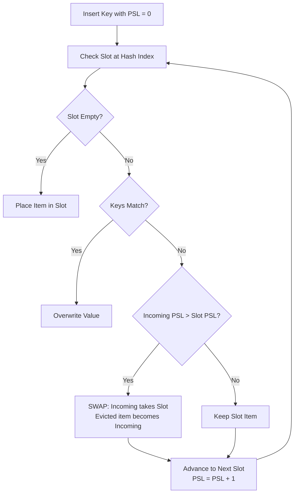

# The Robin Hood Hash Table: Mastering Cache-Locality and Low-Variance Probing

---

### 1. 💡 The "Big Picture" (Plain English)

#### What is this in simple terms?
A **Robin Hood Hash Table** is an open-addressing hash table that dramatically flattens lookup times by **taking from the rich and giving to the poor**. 

In standard linear probing, an unlucky key can get stuck behind an enormous cluster of collisions, causing painful search delays. A Robin Hood hash table tracks how far each item is from its "ideal" bucket (its **Probe Sequence Length**, or **PSL**). If a new item has wandered farther than the item currently sitting in a slot, the new item **steals the slot**, and the displaced item is pushed down the line.

#### Real-World Analogy
Imagine a crowded airport security line where passengers are ordered by their flight departure time:
* A passenger whose flight leaves in **10 minutes** (the "poor" passenger who has waited too long or is running late) walks up to a slot occupied by someone whose flight leaves in **3 hours** (the "rich" passenger who is right next to their target).
* Instead of sending the desperate passenger to the very end of the terminal, the airport marshal swaps them: the late passenger takes the closer spot, and the relaxed passenger happily steps back one spot. 
* Everyone’s wait time becomes remarkably uniform and fair.

#### Why should I care? What problem does it solve today?
Standard Java `HashMap` uses **separate chaining** (arrays of linked nodes or tree bins). While conceptually simple, it suffers from:
1. **Pointer chasing:** Jumping across random heap addresses, constantly evicting CPU L1/L2 cache lines.
2. **Memory bloat:** Every entry requires an extra wrapper node (24–32 bytes of JVM overhead per entry).

Standard **open addressing** (storing keys and values directly in a flat array) solves pointer chasing, but quickly degrades due to **primary clustering**, leading to unpredictable, high-variance tail latencies ($O(N)$ worst-case lookups). 

The Robin Hood Hash Table gives you the best of both worlds: **pure array-backed cache locality** and **tightly bounded, low-variance lookup times**, allowing early termination for failed searches.

---

### 2. 🛠️ How it Works (Step-by-Step)

#### Step-by-Step Mechanics

1. **Calculate Ideal Index & Initial PSL:** Hash the key to find its ideal bucket. Set the item's initial `probeDistance = 0`.
2. **Scan Slots:** Step through contiguous array indices (wrapping around using modulo or bitmask).
3. **Handle Empty Slot:** If an empty bucket is found, insert the item and terminate.
4. **Compare PSLs on Collision:**
   * If the slot's current occupant has the same key, update the value.
   * If the incoming item has traveled **further** than the existing occupant (`incoming.psl > existing.psl`), swap them! The incoming item takes the slot, and the displaced item becomes the new "incoming item" with its PSL preserved.
   * Increment the current `probeDistance` and proceed to the next slot.
5. **Early Exit Optimization (Lookups):** When searching for a key, if you encounter an occupied slot whose `existing.psl < current_search_psl`, **stop immediately**. The key does not exist. (If it did, it would have stolen that slot or one earlier).

#### Execution Flow



#### Clean Java Implementation

```java
public class RobinHoodHashMap<K, V> {

    private static class Entry<K, V> {
        final K key;
        V value;
        int psl; // Probe Sequence Length: distance from ideal hash index

        Entry(K key, V value, int psl) {
            this.key = key;
            this.value = value;
            this.psl = psl;
        }
    }

    private Entry<K, V>[] table;
    private int size;
    private int capacity;
    private static final float LOAD_FACTOR_THRESHOLD = 0.85f;

    @SuppressWarnings("unchecked")
    public RobinHoodHashMap(int initialCapacity) {
        this.capacity = initialCapacity;
        this.table = (Entry<K, V>[]) new Entry[capacity];
        this.size = 0;
    }

    private int hash(K key) {
        return (key == null) ? 0 : Math.floorMod(key.hashCode(), capacity);
    }

    public void put(K key, V value) {
        if ((float) (size + 1) / capacity >= LOAD_FACTOR_THRESHOLD) {
            resize();
        }

        Entry<K, V> incoming = new Entry<>(key, value, 0);
        int idx = hash(key);

        while (true) {
            Entry<K, V> current = table[idx];

            // Case 1: Empty slot found
            if (current == null) {
                table[idx] = incoming;
                size++;
                return;
            }

            // Case 2: Update existing key
            if (current.key.equals(incoming.key)) {
                current.value = incoming.value;
                return;
            }

            // Case 3: Robin Hood Swap ("Take from the rich, give to the poor")
            if (incoming.psl > current.psl) {
                Entry<K, V> temp = current;
                table[idx] = incoming;
                incoming = temp; // Displaced entry now needs to find a home
            }

            // Advance to the next bucket
            incoming.psl++;
            idx = (idx + 1) % capacity;
        }
    }

    public V get(K key) {
        int idx = hash(key);
        int currentPsl = 0;

        while (true) {
            Entry<K, V> current = table[idx];

            // Rule 1: Empty slot -> Key doesn't exist
            // Rule 2: Current PSL < search PSL -> Key cannot exist further ahead
            if (current == null || currentPsl > current.psl) {
                return null; 
            }

            if (current.key.equals(key)) {
                return current.value;
            }

            currentPsl++;
            idx = (idx + 1) % capacity;
        }
    }

    @SuppressWarnings("unchecked")
    private void resize() {
        Entry<K, V>[] oldTable = table;
        this.capacity *= 2;
        this.table = (Entry<K, V>[]) new Entry[capacity];
        this.size = 0;

        for (Entry<K, V> entry : oldTable) {
            if (entry != null) {
                put(entry.key, entry.value);
            }
        }
    }
}
```

---

### 3. 🧠 The "Deep Dive" (For the Interview)

#### The Hardware & Low-Level Mechanics
* **Cache Line Utilization ($64\text{ bytes}$):** A modern x86/ARM CPU loads memory in 64-byte chunks. In Java's `java.util.HashMap`, looking up an entry requires dereferencing the array index, jumping to a heap address for a `Node`, and potentially following `next` pointers. This triggers repeated **L1/L2 cache misses**. Robin Hood hashing places keys contiguously. A linear probe traverses memory already pulled into the CPU L1 data cache via hardware prefetching.
* **Minimizing PSL Variance ($\sigma^2$):** Standard open-address linear probing exhibits an expected search distance variance of $O(\log N)$. Robin Hood hashing drastically compresses this variance down to $O(1)$ on average. By actively truncating long tail probe sequences, insertion and lookup latencies behave consistently.

#### Deletion: The "Backward Shift" Algorithm
A naive open addressing deletion places a dummy marker (`TOMBSTONE`), which pollutes the array and degrades lookup speeds. Robin Hood Hash Tables solve this via **Backward Shift Deletion**:
1. Remove entry at index $i$.
2. Inspect bucket $i+1$. If the entry has a $\text{PSL} > 0$, shift it backward to index $i$, and decrement its PSL by 1.
3. Repeat shifting subsequent items backward until hitting an empty bucket or an entry with $\text{PSL} = 0$.
4. **Result:** No tombstones, zero search degradation, and continuous consolidation of probe clusters.

#### Trade-offs
* **Insertion Latency vs. Read Latency:** Insertions can incur multiple memory writes when cascading swaps occur. However, reads are blazingly fast and fail fast via the PSL check.
* **Load Factor Sensitivity:** Robin Hood operates well up to an $85\text{--}90\%$ load factor. Beyond $90\%$, cascade displacement during insertions causes write stalls.
* **Key/Value Object Footprint:** If implemented with an array of wrapper objects, you still incur pointer costs. High-performance production variants (e.g., in Rust's `hashbrown` or C++ flat maps) store parallel primitive arrays (`byte[] psls`, `K[] keys`, `V[] values`) to achieve true zero-indirection contiguous layout.

---

#### Interviewer Probe Questions

1. **"Why can a search in a Robin Hood hash table terminate before finding an empty slot?"**
   * *Answer:* Because of the swap invariant: no element can occupy a slot if an arriving candidate had a higher PSL. Therefore, the PSLs in any continuous collision run are kept in non-decreasing order relative to their displacement. If our current probe count exceeds the slot's PSL, our key could not have been shifted past this point without having evicted the incumbent. We can safely conclude the key does not exist.

2. **"Why is Backward Shift Deletion strictly superior to Tombstones in this data structure?"**
   * *Answer:* Tombstones do not decrement the probe lengths of subsequent items. Searches must treat tombstones as occupied slots, keeping worst-case probe lengths inflated. Backward shifting pulls subsequent items closer to their ideal home, directly reducing their PSL and restoring optimal cache line locality while preserving the search termination invariant.

3. **"How does Robin Hood Hashing compare to Cuckoo Hashing?"**
   * *Answer:* Cuckoo hashing offers deterministic $O(1)$ worst-case lookup by using 2 (or more) hash functions and guaranteeing an item can only reside in one of those fixed locations. However, Cuckoo hashing has high insertion variance (risk of infinite loops requiring table rehashes) and exhibits poor CPU cache behavior due to jumping between multiple hash tables. Robin Hood hashing has higher worst-case read time than Cuckoo, but significantly higher cache locality and predictable inserts under moderate load factors.

---

### 4. ✅ Summary Cheat Sheet

#### 3 Key Takeaways
1. **The Invariant:** "Take from the rich, give to the poor." Entries with lower Probe Sequence Lengths yield their slots to entries with higher PSLs.
2. **Early Negative Lookup:** Searches don't need to hit a `null` to know an item is missing; encountering an entry with `slot.psl < current_search_psl` provides immediate termination.
3. **Cache Friendly:** Linear memory scanning beats pointer chasing every time on modern CPU architectures.

#### 1 Golden Rule to Remember
> *If an incoming entry has traveled farther from its home than the current tenant has, evict the tenant and swap places—it guarantees the lowest variance in probe lengths across the entire table.*