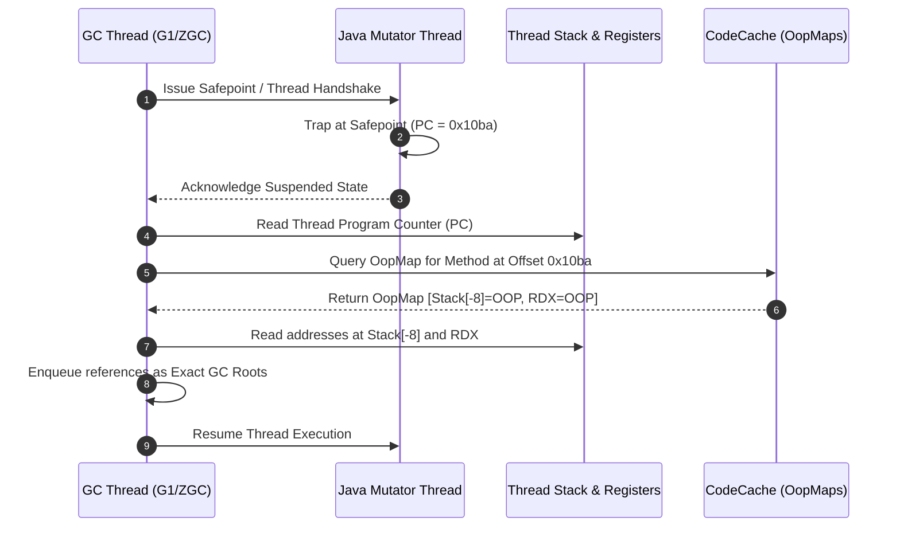

# JVM GC Roots and OopMaps: Exact Stack Scanning and Pointer Identification

---

### 1. 💡 The "Big Picture" (Plain English)

#### What is this in simple terms?
When modern garbage collectors (like G1 or ZGC) run, their first task is to find all "live" objects starting from **GC Roots** (active local variables, CPU registers, static fields). 

However, at the CPU hardware level, a 64-bit value inside a register or stack slot is just a stream of 1s and 0s. The CPU does not know whether `0x7FFF5FBFFD98` is a memory address pointing to a `Customer` object on the heap or simply an `unsigned long` tracking a crypto transaction amount. 

**OopMaps** (Ordinary Object Pointer Maps) are data structures generated by the JIT compiler that tell the JVM precisely which registers and stack slots hold real object references at any given instruction. This enables the JVM to be an **Exact (Precise) GC** rather than a **Conservative GC** that has to guess.

```
       Stack Slot / Register
      +----------------------+
      | 0x00007FFF5FBFFD98   | ===> Is this an Object reference or a long integer?
      +----------------------+
                 │
                 ▼
       Consulting JIT OopMap:
       Offset 42: [R10=OOP, R11=PRIMITIVE, Stack[-8]=OOP]
                 │
                 └───> JVM identifies it with 100% certainty!
```

#### The Real-World Analogy
Imagine an airport customs checkpoint where travelers hold identical unmarked steel briefcases. 
* A **Conservative system** would have to assume *every* briefcase might contain dangerous chemicals and open them all, or worse, avoid moving them out of fear.
* An **Exact system with OopMaps** is like having an automated flight manifest indexed by seat number and flight second. The customs officer looks at the log: *"At gate 4B, passenger in seat 12A is holding government bonds (value/primitive), but passenger 12B is holding a licensed sample (reference)."* No guessing, no false alarms, and zero time wasted inspecting values that are just numbers.

#### Why should I care? What problem does it solve for me today?
1. **Zero Heap Corruption:** If a GC mistook an integer for a pointer and updated it during G1/ZGC object evacuation (relocation), your data would be instantly corrupted.
2. **Zero Memory Leaks from False Pointers:** In conservative collectors (like standard C/C++ garbage collectors), an integer whose value happens to match a dead object’s heap address prevents that object (and its entire child graph) from ever being freed.
3. **Sub-Millisecond Pauses:** OopMaps allow G1 and ZGC to scan thread execution stacks in microseconds during root-scanning phases without inspecting every word in the thread's memory.

---

### 2. 🛠️ How it Works (Step-by-Step)

#### The Step-by-Step Lifecycle

1. **JIT Compilation Analysis:** As the HotSpot C1/C2 JIT compiler emits machine code for a method, it tracks the state of every CPU register and stack slot across basic blocks.
2. **Safepoint Attachment:** The JIT compiler cannot generate OopMaps for every single machine instruction (the metadata would consume gigabytes). Instead, it records OopMaps **only at Safepoints** (method entries, loop back-edges, call sites, and explicit allocations).
3. **Execution & Suspension:** When a GC cycle starts (e.g., G1 Initial Mark or ZGC Thread Handshake), all mutator threads stop at their nearest safepoints.
4. **Stack Walking:** The GC thread inspects the program counter (PC) of each suspended thread, finds the compiled code chunk, and looks up the exact OopMap mapped to that PC offset.
5. **Pointer Extraction:** The GC extracts the true references (`oops`), pushes them to the mark queue as GC roots, and ignores all primitive numbers.

#### Java Code Example and What the JVM Emits Under the Hood

```java
public class RootScanningDemo {
    private static Object globalRoot = new Object(); // Metaspace/Class Root

    public void processTransaction(int accountId, Object transactionData) {
        // Primitive variable: stored in a CPU register or stack slot as raw bits
        long bitMask = 0x7FFF_0000_1234_5678L;

        // Reference variable: points to the Java Heap
        String status = new String("PROCESSED");

        // SAFEPOINT CANDIDATE: Method call
        // When pause happens here, JIT compiler has registered an OopMap for this PC.
        auditCheckpoint(status);

        // At this point, 'status' is still live, 'bitMask' is still in register
        System.out.println(accountId + ": " + status.length() + bitMask);
    }

    private void auditCheckpoint(Object data) {
        // Simulating allocation that might trigger GC
        byte[] auditLog = new byte[1024];
    }
}
```

```
HotSpot JIT Assembly & OopMap Metadata (Conceptual Machine Code Mapping):
---------------------------------------------------------------------------------------
Instruction Offset | Assembly Instruction           | JIT Metadata (OopMap)
---------------------------------------------------------------------------------------
0x10a4             | movq  %rsi, -8(%rsp)           | None
0x10a8             | movabsq $0x7fff0000..., %r10   | None
0x10b2             | movq  %rdi, %rdx               | None
0x10b5             | callq auditCheckpoint          | [PC=0x10ba: Stack[-8]=OOP, RDX=OOP]
                   |                                | *Note: %r10 (bitMask) is ignored!*
0x10ba             | testl %eax, SafepointPollPage  | Safepoint Poll Check
---------------------------------------------------------------------------------------
```

#### Stack Scanning Flow During GC



---

### 3. 🧠 The "Deep Dive" (For the Interview)

#### The Internal Architecture: OopMap Types and Compression
HotSpot implements three distinct categories of OopMaps inside the runtime:

1. **OopMap:** Constructed during JIT compilation (C1/C2) and attached to a code-generation block.
2. **OopMapSet:** A collection of `OopMap` instances belonging to an entire compiled method (`nmethod`), indexed by instruction offset.
3. **ImmutableOopMap:** To save memory, HotSpot compresses raw JIT OopMaps into a shared, immutable bitmap format after compilation. Stored inside the non-method code heap of the JVM, it uses bit vectors where a set bit (`1`) indicates an object reference and `0` indicates a primitive or dead slot.

#### Derived Pointers: The Pointer Arithmetic Challenge
When the C2 compiler optimizes code (e.g., auto-vectorization, loop array indexing), it frequently creates **Derived Pointers**—addresses pointing directly inside an array or struct rather than at the object header:

$$\text{Derived Pointer} = \text{Base Object Reference} + \text{Byte Offset}$$

If G1 or ZGC relocates an array during compaction, the base object reference changes. If the JVM only updated the base reference, the derived pointer would still point to the old, uncompacted memory location, causing a catastrophic memory fault.

```
       Original Base Object
      [ Header | Elements... (Offset 16) ... ]
         ▲                        ▲
         │                        │
     Base Pointer          Derived Pointer (Base + 16)
         
     --- [ GC Compaction & Relocation Occurs ] ---
     
       Moved Base Object
      [ Header | Elements... (Offset 16) ... ]
         ▲                        ▲
         │                        │
     New Base Pointer      Updated Derived Pointer (New Base + 16)
```

HotSpot's OopMap mechanism solves this by tracking pointer pairs: `[Base, Derived]`. During GC stack scanning:
1. The collector computes: $\Delta = \text{Old Base Address} - \text{Derived Address}$.
2. The collector updates the base object to its new relocated address.
3. The collector re-derives the pointer: $\text{New Derived Address} = \text{New Base Address} - \Delta$.

#### Architectural Trade-offs

| Strategy / Aspect | Exact GC with OopMaps (HotSpot) | Conservative GC (e.g., Boehm-GC) |
| :--- | :--- | :--- |
| **Relocation / Compaction** | **Fully Supported:** Objects can be moved safely because every pointer is known and updated. | **Impossible / Restricted:** Cannot safely rewrite values because an integer might accidentally be altered. |
| **Memory Footprint** | **Higher Native Memory:** Requires auxiliary storage in Metaspace and CodeCache for `ImmutableOopMaps`. | **Zero Metadata Overhead:** No need to emit compiler tables or store offset maps. |
| **Stack Inspection Speed** | **Instantaneous:** Read bitmask, read indices, done. Scales with root count. | **Slow:** Must scan every 4 or 8 bytes of the thread stack linearly and perform pointer-range checks. |

---

### 4. 🧑‍💻 Interviewer Probes & Defenses

#### Probe 1: *"Why doesn't the JIT compiler emit an OopMap for every single assembly instruction?"*
* **Candidate Defense:** "Emitting an OopMap at every instruction would cause massive memory bloat in the CodeCache. An average instruction is only 2 to 5 bytes, whereas a single uncompressed OopMap bit vector can take 8 to 32 bytes depending on register and stack frame depth. 
  
  To keep native memory overhead minimal (typically <1-3% of code cache), the JVM only generates OopMaps at **safepoint-safe locations**—such as method calls, loop back-edges, and allocation sites. Threads only pause at these predetermined locations, meaning the JVM never needs to resolve the pointer layout between these points."

#### Probe 2: *"How does ZGC scan GC roots without incurring the long Stop-The-World (STW) pauses typical of older collectors?"*
* **Candidate Defense:** "Both G1 and older parallel collectors traditionally pause all threads simultaneously to scan the entire stack of every thread. ZGC changes this paradigm using **Thread-Local Handshakes**. 

  Instead of bringing the whole world to a global safepoint, ZGC executes a handshake with **one thread at a time**. It pauses a single thread, walks its stack frames using its corresponding `ImmutableOopMaps`, marks and 'heals' (colors) its roots directly on the stack via the load barrier protocol, and immediately resumes that thread. The pause time per thread is negligible (typically sub-microseconds), keeping total application pause times consistently under 1 millisecond regardless of heap size."

#### Probe 3: *"What is an 'Uncompressed OOP' vs a 'Compressed OOP' during OopMap stack traversal?"*
* **Candidate Defense:** "On 64-bit systems with heaps under 32GB, HotSpot uses Compressed OOPs (`-XX:+UseCompressedOops`) to encode 64-bit pointers into 32-bit integers in the heap by right-shifting by 3 bits. 
  
  However, on CPU registers and local stack variables, references are **uncompressed into native 64-bit addresses** when loaded for immediate dereferencing by the execution engine. The JIT's OopMap specifically designates register and stack-frame locations as native 64-bit pointer slots so the GC root scanner does not incorrectly apply decompression logic to roots already residing in raw 64-bit CPU registers."

---

### 5. ✅ Summary Cheat Sheet

#### 3 Key Takeaways
1. **OopMaps enable Exact GC:** They prevent the JVM from guessing whether an ambiguous binary value in a register or stack slot is an object reference or a primitive integer.
2. **Safepoint Bound:** JIT compilers only emit OopMaps at safepoints to strike a balance between zero-latency pointer identification and low CodeCache memory consumption.
3. **Derived Pointer Protection:** OopMaps track compiler-generated internal offsets, allowing G1 and ZGC to relocate objects and update pointer offsets without memory corruption.

#### 1 "Golden Rule"
> **The JVM does not know what is on the stack by inspecting the data itself; it knows what is on the stack by consulting the JIT's compiler map (OopMap) for the current Instruction Pointer.**