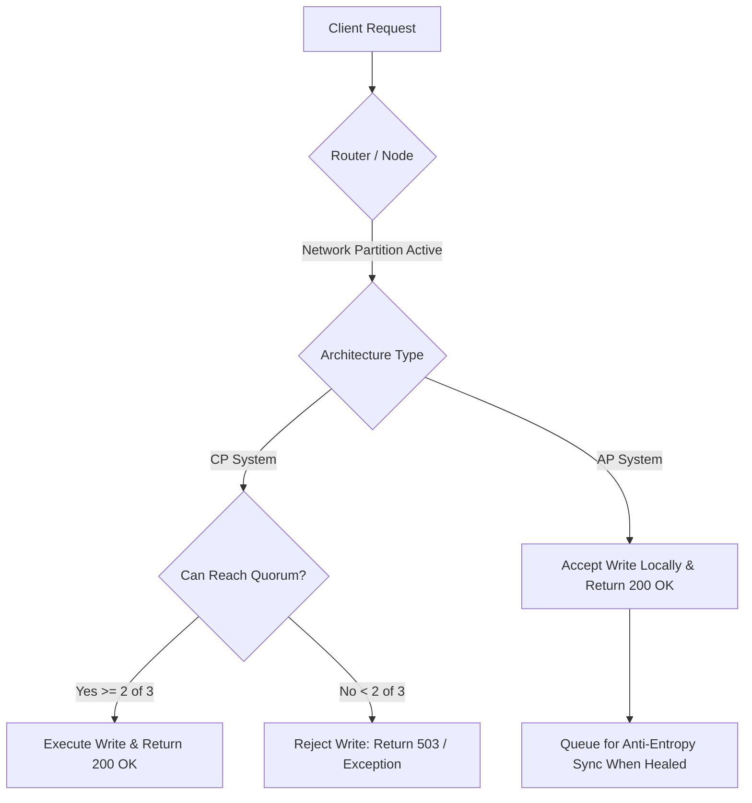

# The CAP Theorem: Operational Mechanics of Choosing AP vs. CP Under Partition

---

### 1. 💡 The "Big Picture" (Plain English)

#### What is this in simple terms?
In any system where multiple computers share and store data across a network, hardware components will eventually fail: cables snap, network switches crash, and routers drop packets. This breakdown in communication is called a **Network Partition ($P$)**.

The **CAP Theorem** proves mathematically that when a partition happens, you cannot have both up-to-the-millisecond identical data everywhere (**Consistency - $C$**) and guarantee that every surviving node can immediately answer requests (**Availability - $A$**). 

Because network partitions in the real world are unavoidable, you cannot pick "CA". **Your only choice is between AP and CP.**

```
       [ Consistency ]
           /      \
          /        \
         /   Pick   \
        /     Two    \
       /   (P is a    \
      /    Given!)     \
[ Availability ] --- [ Partition Tolerance ]
```

#### Real-World Analogy
Imagine a retail bank with two branches: Branch Uptown and Branch Downtown. They share account balances over a telephone wire.

Suddenly, a construction crew cuts the phone wire between them. This is a **Network Partition ($P$)**.

Now, Alice walks into Branch Uptown and deposits \$100. Simultaneously, her business partner walks into Branch Downtown to withdraw all their money.

* **The CP Choice (Consistency + Partition Tolerance):**  
  Branch Downtown says: *"Our phone line to Uptown is down. I cannot verify your current balance or guarantee Uptown won't let you double-spend. Therefore, I must reject your withdrawal request."*  
  **Result:** The data remains 100% accurate, but the system is unavailable to Downtown customers.

* **The AP Choice (Availability + Partition Tolerance):**  
  Branch Downtown says: *"Our phone line is down, but we never turn down a customer! Here is your cash."* Downtown logs the transaction on a paper ledger to resolve later.  
  **Result:** The customer gets served immediately, but the bank risks a negative balance or double-spending once the network heals.

#### Why should I care today?
Every distributed datastore you configure—from MongoDB and PostgreSQL read replicas to Cassandra, DynamoDB, and Redis—forces this architectural choice. If you pick **AP** for a ledger or checkout cart, you risk losing inventory or money. If you pick **CP** for a social media feed or product catalog, your users will see annoying "503 Service Unavailable" error pages during routine network hiccups.

---

### 2. 🛠️ How it Works (Step-by-Step)

When a network split divides a 3-node cluster into two isolated sides (a majority partition of 2 nodes and a minority partition of 1 node), the architecture routes traffic according to its CAP design:

```
                  Client Writes Data
                  [ Value = "Foo" ]
                          |
             +------------+------------+
             |                         |
             v                         v
     [ Majority Partition ]   [ Minority Partition ]
     +--------+  +--------+          +--------+
     | Node A |==| Node B |    XX    | Node C | (Isolated)
     +--------+  +--------+          +--------+
```

1. **Step 1: Partition Detection.** Heartbeats fail between Node C and Nodes A/B. Both sides recognize a split.
2. **Step 2: Incoming Request.** A client issues a write (`Value = "Foo"`) to the isolated Node C.
3. **Step 3 (CP Path): Quorum Check.** Node C asks: *"Can I reach a majority quorum ($N/2 + 1 = 2$ nodes) to confirm this write?"*
   * The answer is **No**.
   * Node C rejects the request (`503 Service Unavailable`). It refuses to risk stale reads or split-brain writes.
4. **Step 4 (AP Path): Local-First Acceptance.** Node C asks: *"Am I alive?"*
   * The answer is **Yes**.
   * Node C writes the value locally, marks it with a timestamp/version, and returns `200 OK`.
5. **Step 5: Reconciliation (Healing).** When the network cable reconnects:
   * **CP:** Node C downloads the authoritative log from the majority and catches up automatically.
   * **AP:** Nodes exchange conflicting records and must run a conflict-resolution strategy (e.g., Last-Write-Wins, Vector Clocks, or CRDT merges).

#### Flow Architecture



#### Code Implementation: AP vs. CP Node Logic

Below is a clean, dependency-free Python implementation modeling how a cluster node responds to a write during a partition:

```python
from enum import Enum
from typing import Dict, Any

class SystemMode(Enum):
    CP = "CONSISTENCY_PARTITION"
    AP = "AVAILABILITY_PARTITION"

class ClusterNode:
    def __init__(self, node_id: str, total_nodes: int, mode: SystemMode):
        self.node_id = node_id
        self.total_nodes = total_nodes
        self.mode = mode
        self.data_store: Dict[str, Any] = {}
        self.version_log: Dict[str, int] = {}

    def write(self, key: str, value: Any, reachable_nodes: int) -> dict:
        """
        Simulates handling a write request under network isolation.
        'reachable_nodes' includes self + any peers currently reachable.
        """
        quorum_size = (self.total_nodes // 2) + 1

        if self.mode == SystemMode.CP:
            # CP REQUIREMENT: Must achieve quorum consensus
            if reachable_nodes < quorum_size:
                # Node refuses to accept divergent state
                raise ConnectionError(
                    f"[CP ERROR] Node {self.node_id} isolated. "
                    f"Quorum requires {quorum_size} nodes, but only {reachable_nodes} reachable. "
                    f"Write rejected to preserve consistency."
                )
            
            # Quorum reached: Commit data
            self.data_store[key] = value
            self.version_log[key] = self.version_log.get(key, 0) + 1
            return {"status": "SUCCESS", "node": self.node_id, "version": self.version_log[key]}

        elif self.mode == SystemMode.AP:
            # AP REQUIREMENT: Always available to the client if node is alive
            self.data_store[key] = value
            self.version_log[key] = self.version_log.get(key, 0) + 1
            
            flag = "CONSISTENT" if reachable_nodes >= quorum_size else "DEGRADED_DIRTY"
            return {
                "status": "SUCCESS", 
                "node": self.node_id, 
                "version": self.version_log[key],
                "replication_state": flag
            }

# --- Demonstration ---
if __name__ == "__main__":
    # Cluster of 3 nodes: Node C is isolated (can only reach 1 node: itself)
    cp_node_c = ClusterNode(node_id="C", total_nodes=3, mode=SystemMode.CP)
    ap_node_c = ClusterNode(node_id="C", total_nodes=3, mode=SystemMode.AP)

    # 1. Test CP Node behavior during partition
    try:
        cp_node_c.write(key="account_balance", value=500, reachable_nodes=1)
    except ConnectionError as e:
        print(e)  # Output: Rejects write to prevent inconsistency

    # 2. Test AP Node behavior during partition
    ap_result = ap_node_c.write(key="account_balance", value=500, reachable_nodes=1)
    print(f"[AP SUCCESS] Node accepted write: {ap_result}")
    # Output: Accepts write immediately, flags state for later sync
```

---

### 3. 🧠 The "Deep Dive" (For the Interview)

#### The Academic Precision of CAP
In interviews, candidates often conflate the letters of CAP with standard database acronyms. Knowing the formal definitions (established by Seth Gilbert and Nancy Lynch in their 2002 proof) immediately distinguishes you:

* **$C$ (Consistency) means *Linearizability***: It does **not** mean ACID consistency (which is about database schema invariants). In CAP, consistency strictly means **atomic consistency**: every read must return the value of the most recent write, regardless of which node serves the request. It acts as if there is only a single copy of the data item in existence.
* **$A$ (Availability) means *100% Non-Error Responses***: Every non-failing node must return a non-error response for every received request. Returning a `500 Server Error`, a timeout, or a `Cannot reached leader` exception violates CAP availability.
* **$P$ (Partition Tolerance)**: The network drops arbitrary numbers of messages sent from one node to another. You cannot "opt out" of $P$; modern physics, GC pauses, router misconfigurations, and top-of-rack switch drops guarantee that networks will partition.

#### CP Internals: Quorums and Distributed Consensus
CP databases (e.g., **CockroachDB, Google Spanner, etcd, ZooKeeper**) leverage consensus algorithms like **Raft** or **Paxos**.

* **Leader Leases & Heartbeats**: A single leader accepts writes. To remain the leader, it must continuously renew its lease by collecting heartbeats from a quorum of followers ($Q = \lfloor N/2 \rfloor + 1$).
* **Minority Partition Handling**: If a network split isolates the leader in a minority partition, it will fail to renew its lease. The majority partition elects a new leader. Until the isolated leader notices this failure, it will either block requests or throw errors.
* **Cost**: High latency on WAN writes (cross-datacenter round-trips for quorum commits) and total write stalls on minority partitions during split-brain events.

#### AP Internals: Gossip, Hinted Handoff, and CRDTs
AP databases (e.g., **Apache Cassandra, Amazon DynamoDB, Couchbase**) rely on masterless architectures and peer-to-peer protocols.

* **Sloppy Quorums & Hinted Handoff**: If Node C is unreachable, Node A accepts the write and temporarily saves a "hint" locally. Once Node C reconnects, Node A replays the hint.
* **Reconciliation Complexity**: 
  * **Last-Write-Wins (LWW)**: Uses wall-clock timestamps (`System.currentTimeMillis()`). *Vulnerable to NTP clock skew*, which silently drops valid writes.
  * **Vector Clocks / Version Vectors**: Captures causal relationships ($A \to B$). If concurrent divergent writes occur, the client application is handed both versions to resolve manually (e.g., Git merge conflicts or Amazon's famous "resurrected cart item" bug).
  * **Conflict-Free Replicated Data Types (CRDTs)**: State-based or operation-based mathematical structures that commute: $Merge(A, B) = Merge(B, A)$. Ideal for counters, grow-only sets, and collaborative text editing, but difficult to model for complex relational entities.

#### Architectural Trade-offs

| Dimension | CP (Consistency + Partition Tolerance) | AP (Availability + Partition Tolerance) |
| :--- | :--- | :--- |
| **Primary Guarantee** | Single-source-of-truth correctness. | Zero downtime, ultra-fast write paths. |
| **Failure Behavior** | Returns HTTP 5xx / timeouts on partition. | Accepts stale reads and divergent writes. |
| **Write Latency** | High (must wait for Quorum/Raft round-trips). | Low (writes to local memory/commit log immediately). |
| **System Complexity** | Complex consensus engine (Raft/Paxos). | Complex read repair, CRDTs, and anti-entropy engines. |
| **Best For** | Banking, authentication, locks, inventory. | Social feeds, metrics, clickstreams, shopping carts. |

#### Interviewer Probes (Tricky Edge Cases)

##### 1. "Can we build a CA system inside a single, highly redundant cloud data center?"
> **Candidate Answer:** *"No. While AWS or GCP offer high intra-datacenter reliability, partitions are not limited to severed physical cables. An unhandled Stop-The-World (STW) JVM Garbage Collection pause, OS process swapping, hypervisor CPU throttling, or a saturated NIC will make a node unresponsive for seconds. From the cluster's perspective, this node has partitioned. If the system continues serving reads and writes without verifying partition state, consistency is lost. Therefore, CA is an illusion in distributed environments."*

##### 2. "If I configure Cassandra with `Read Quorum + Write Quorum > Replication Factor`, does it become a CP system?"
> **Candidate Answer:** *"No, it becomes a system with **Strong Eventual Consistency**, but it does not achieve CAP consistency (Linearizability). Standard quorum Cassandra still uses Last-Write-Wins (LWW) based on client timestamps, making it vulnerable to NTP drift where a newer write is silently dropped by an older clock. Furthermore, Cassandra does not prevent write races during network splits unless you use heavyweight **Paxos-backed Lightweight Transactions (LWT)**, which significantly degrades performance."*

##### 3. "How does the PACELC theorem expand on CAP?"
> **Candidate Answer:** *"CAP only describes system behavior **during** a network partition ($P$). The PACELC theorem recognizes that partitions are rare, stating:*
> 
> *If **P**artition: choose between **A**vailability and **C**onsistency;  
> **E**lse: choose between **L**atency and **C**onsistency.*
> 
> *For example, MongoDB defaults to **PC/EC** (chooses consistency in both states), while Cassandra defaults to **PA/EL** (chooses availability during partitions, and minimizes latency during normal operations by avoiding distributed synchronization)."*

---

### 4. ✅ Summary Cheat Sheet

#### 3 Key Takeaways
1. **Network Partitions ($P$) are a physical reality:** You cannot choose "CA". You can only architect how your system behaves when communication breaks down: either fail safely (CP) or accept dirty reads/writes (AP).
2. **"C" means Linearizability, "A" means No Errors:** CAP consistency is atomic correctness across all nodes, not ACID transactional safety. CAP availability means 100% of non-failing nodes respond without errors or timeouts.
3. **Reconciliation is the hidden cost of AP:** AP is not "free availability." You are simply deferring the cost of consistency to asynchronous background workers (anti-entropy repair, vector clock resolution, or CRDT merges).

#### 1 "Golden Rule"
> **If money, inventory, or security permissions are on the line, build CP (fail early rather than corrupt state). If user engagement, low latency, or 24/7 uptime drive the business, build AP and automate reconciliation.**