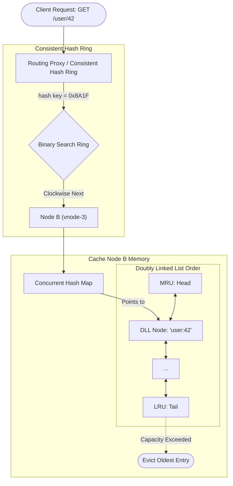

# Scalable Distributed In-Memory Cache: Consistent Hash Ring Routing and Thread-Safe LRU Eviction

---

### 1. 💡 The "Big Picture" (Plain English)

#### What is this in simple terms?
A **Distributed Cache** is a system that stores frequently accessed data across a cluster of servers in ultra-fast RAM. It uses two foundational concepts working in harmony:
1. **Consistent Hashing:** Determines *which server* holds your key without reshuffling the entire system whenever a server joins or crashes.
2. **LRU (Least Recently Used) Eviction:** Determines *what data to delete* on an individual server when its local RAM is full.

#### Real-World Analogy: The Global Postal Network
Imagine a massive library warehouse with 10 branch librarians standing along a round counter (the **Consistent Hash Ring**). 
* When a visitor brings a book (a **Key**), a routing clerk looks at the book’s title, assigns it an angle on the circular counter, and gives it to the *first librarian standing clockwise* from that position. If a librarian takes a break, only their books are handed to the next librarian over; everyone else keeps working unaffected.
* Each librarian has a small rolling cart next to them that holds only 50 books (the **Local LRU Cache**). When a librarian needs to put a new book on a full cart, they drop the book that nobody has requested for the longest time into the basement archive.

#### Why should I care?
Without distributed caching, a spike in traffic hits your primary database directly, causing connection pool exhaustion, latency spikes, and complete system outages. 
* Naive hashing (`hash(key) % N`) causes **cache stampedes**: adding a single node remaps almost 100% of keys, clearing the cache instantly and crushing your database.
* Unbounded memory causes `Out Of Memory` (OOM) crashes. Consistent Hashing paired with local LRU eviction provides horizontal scalability, predictable hit ratios, and bounded memory footprints.

---

### 2. 🛠️ How it Works (Step-by-Step)

#### The End-to-End Request Lifecycle
1. **Key Hashing:** The client/proxy hashes the requested key into a 64-bit integer space.
2. **Ring Lookup:** Using a sorted list of virtual nodes, the system performs a binary search (`O(log V)`) to locate the nearest clockwise node.
3. **Network Dispatch:** The request is forwarded via gRPC/TCP to the designated cache node.
4. **Local Store Query:** The node looks up the key in its local `HashMap`.
5. **LRU Cache Hit:** If found, the node moves the entry to the head of a doubly linked list (`O(1)`) and returns the payload.
6. **LRU Cache Miss:** If missing, the caller fetches data from the backing store, writes it to the cache node's head, and—if capacity is exceeded—drops the tail node (`O(1)`).

#### Architecture & Data Flow



#### Production-Grade Python Reference Implementation

The following implementation combines a **Consistent Hash Ring** (with virtual nodes) and a **Thread-Safe LRU Cache**.

```python
import hashlib
import bisect
import threading
from typing import Any, Optional

class DoublyLinkedListNode:
    def __init__(self, key: str, value: Any):
        self.key = key
        self.value = value
        self.prev: Optional['DoublyLinkedListNode'] = None
        self.next: Optional['DoublyLinkedListNode'] = None

class ThreadSafeLRUCache:
    """Node-level O(1) in-memory storage with LRU eviction."""
    def __init__(self, capacity: int):
        self.capacity = capacity
        self.cache: dict[str, DoublyLinkedListNode] = {}
        self.lock = threading.Lock()
        
        # Sentinel head and tail to eliminate null-checks in pointer wiring
        self.head = DoublyLinkedListNode("", None)
        self.tail = DoublyLinkedListNode("", None)
        self.head.next = self.tail
        self.tail.prev = self.head

    def _remove(self, node: DoublyLinkedListNode) -> None:
        node.prev.next = node.next
        node.next.prev = node.prev

    def _add_to_head(self, node: DoublyLinkedListNode) -> None:
        node.next = self.head.next
        node.prev = self.head
        self.head.next.prev = node
        self.head.next = node

    def get(self, key: str) -> Optional[Any]:
        with self.lock:
            if key not in self.cache:
                return None
            node = self.cache[key]
            self._remove(node)
            self._add_to_head(node)
            return node.value

    def put(self, key: str, value: Any) -> None:
        with self.lock:
            if key in self.cache:
                node = self.cache[key]
                node.value = value
                self._remove(node)
                self._add_to_head(node)
                return

            if len(self.cache) >= self.capacity:
                lru = self.tail.prev
                self._remove(lru)
                del self.cache[lru.key]

            new_node = DoublyLinkedListNode(key, value)
            self.cache[key] = new_node
            self._add_to_head(new_node)


class ConsistentHashRing:
    """Cluster-level routing ring using Virtual Nodes."""
    def __init__(self, replicas: int = 150):
        self.replicas = replicas  # Virtual nodes per physical node
        self.ring: list[int] = []  # Sorted hash values
        self.vnode_to_node: dict[int, str] = {}  # Ring position -> Physical Node ID
        self.nodes: dict[str, ThreadSafeLRUCache] = {}
        self.lock = threading.RLock()

    def _hash(self, key: str) -> int:
        return int(hashlib.md5(key.encode('utf-8')).hexdigest(), 16)

    def add_node(self, node_id: str, capacity: int = 1000) -> None:
        with self.lock:
            self.nodes[node_id] = ThreadSafeLRUCache(capacity)
            for i in range(self.replicas):
                v_key = f"{node_id}#vnode_{i}"
                v_hash = self._hash(v_key)
                bisect.insort(self.ring, v_hash)
                self.vnode_to_node[v_hash] = node_id

    def remove_node(self, node_id: str) -> None:
        with self.lock:
            if node_id not in self.nodes:
                return
            del self.nodes[node_id]
            new_ring = []
            for v_hash in self.ring:
                if self.vnode_to_node[v_hash] == node_id:
                    del self.vnode_to_node[v_hash]
                else:
                    new_ring.append(v_hash)
            self.ring = new_ring

    def get_node(self, key: str) -> Optional[ThreadSafeLRUCache]:
        with self.lock:
            if not self.ring:
                return None
            key_hash = self._hash(key)
            idx = bisect.bisect_right(self.ring, key_hash)
            # Wrap-around behavior for circular ring mechanics
            if idx == len(self.ring):
                idx = 0
            target_node_id = self.vnode_to_node[self.ring[idx]]
            return self.nodes[target_node_id]
```

---

### 3. 🧠 The "Deep Dive" (For the Interview)

#### The Internal Mechanics

##### 1. Why Virtual Nodes (Vnodes) are Non-Negotiable
If you hash only physical nodes (e.g., IP addresses) to the ring, points on the circle end up clustered due to non-uniform hash distribution. This creates **hot spots** where one server gets 60% of the traffic. 
* By creating $V$ virtual labels for each physical machine (e.g., `NodeA#0`, `NodeA#1`, ..., `NodeA#149`), tokens are uniformly distributed across the hash space.
* When adding a physical node, it steals a small slice of keys from *all* existing nodes, rather than taking a massive chunk from just one neighbor.

##### 2. The Concurrency Problem in LRU: The "Read is a Write" Trap
In a classic LRU implementation, `get(key)` must move the accessed item to the head of the Doubly Linked List. **This makes every read operation a state mutation.**
* If guarded by a single global lock (mutex), concurrent reads across multiple CPU cores serialize, destroying throughput.
* **Production Solutions:**
  * **Lock-Striping:** Shard the local LRU into 16 or 32 sub-LRUs keyed by `hash(key) % shards`.
  * **Asynchronous Buffer / Ring Buffers (e.g., Caffeine Cache):** Reads acquire no list locks. Instead, they record the read event in a lock-free ring buffer (similar to a write-ahead log). A background worker thread or periodic draining batch-reorders the Doubly Linked List.
  * **Sampling LRU (Redis approach):** Drop the Doubly Linked List entirely. Track a 24-bit timestamp on each key. When memory is full, sample 5 random keys and evict the oldest among that sample. This preserves `O(1)` memory lookup with zero pointer overhead and high concurrency.

##### 3. Failure Domains and Membership Gossip
In production, nodes don't exist in a static array:
* Ring membership is maintained either via a centralized consensus layer (**ZooKeeper / etcd**) or decentralized gossip protocols (**SWIM / Dynamo-style**).
* If a node dies, consistent hashing reroutes requests to the next replica node on the ring. This can cause a **cascading failure** if that successor does not have sufficient capacity to absorb the newly shifted load.

#### Architecture Trade-Offs

| Architecture Decision | Pro | Con |
| :--- | :--- | :--- |
| **High Virtual Node Count (e.g., 250+)** | Near-perfect load balance; zero hot-spots from hashing skew. | Increased memory footprint for storing ring metadata; slower binary lookups (`O(log(N * V))`). |
| **Strict LRU (Doubly Linked List)** | Deterministic, exact eviction of the true least recently used element. | Extreme lock contention on high-read workloads; high memory pointer overhead (16–24 bytes per node). |
| **Client-Side vs. Proxy-Based Routing** | **Client-side:** Lower latency (zero intermediate network hop). | **Proxy-based:** Clients don't need ring awareness or update logic; connection pools are conserved. |

#### Interviewer Probe Questions

##### Probe 1: "What happens when you have a 'Celebrity Key' (e.g., Justin Bieber's profile)? Does Consistent Hashing save you?"
> **Answer:** No. Consistent Hashing only balances the *distribution of distinct keys*, not the *request volume of a single key*. A single viral key always hashes to the exact same ring position, routing all read traffic to a single node and exhausting its CPU/NIC.
> 
> **Remediation:**
> 1. **L1 In-Memory Near-Cache:** Cache ultra-hot keys locally in the application process memory with a short TTL (e.g., 2 seconds).
> 2. **Key-Salting (Spread Reads):** Append random suffixes to hot keys during writes (`key#1`, `key#2`, ..., `key#N`) and distribute them across multiple nodes. The application layer randomly picks a suffix to load-balance reads.

##### Probe 2: "A node drops out of the ring, and requests suddenly route to its neighbor. What happens to the underlying database?"
> **Answer:** This causes a **Cache Stampede (Thundering Herd)**. The neighbor node does not have the keys cached locally. If 10,000 concurrent requests arrive for the same missing key, they will all register a cache miss and simultaneously query the database.
> 
> **Remediation:**
> Implement **Request Collapsing (Singleflight pattern)**. Ensure that for any unique cache key, only one upstream fetch call to the database is in flight at any given moment. Subsequent concurrent misses block and subscribe to the output of that first fetch.

##### Probe 3: "Why use MD5 or Murmur3 for Consistent Hashing instead of Java's built-in `hashCode()` or Python's `hash()`?"
> **Answer:** Built-in language hash functions are not cryptographically uniform and often vary across runtimes, processes, or architecture restarts (e.g., Python randomizes hash seeds per process invocation to prevent DoS attacks). 
> Distributed routing requires a fast, deterministically reproducible, uniform distribution across the entire 32-bit or 64-bit address space. **MurmurHash3** or **xxHash** are chosen for their speed, zero hash-seed divergence, and avalanche properties (where a 1-bit change in input changes ~50% of output bits).

---

### 4. ✅ Summary Cheat Sheet

#### 3 Key Takeaways
1. **Separation of Concerns:** Consistent Hashing distributes load **horizontally** across machines (inter-node); LRU bounds resource utilization **vertically** on a single machine (intra-node).
2. **Virtual Nodes are Crucial:** Never implement consistent hashing without virtual nodes (100–200 replicas per physical node) to avoid structural hot-spots and ring skew.
3. **Strict LRU Contends on Read:** Standard LRU links mutation to access. Real-world high-throughput engines replace global-locked linked lists with sampled LRU (Redis) or lock-free ring-buffered updates (Caffeine).

#### 1 "Golden Rule"
> **Always guard your backing database against cache misses using request collapsing (Singleflight), because consistent hashing guarantees key location, not key existence.**