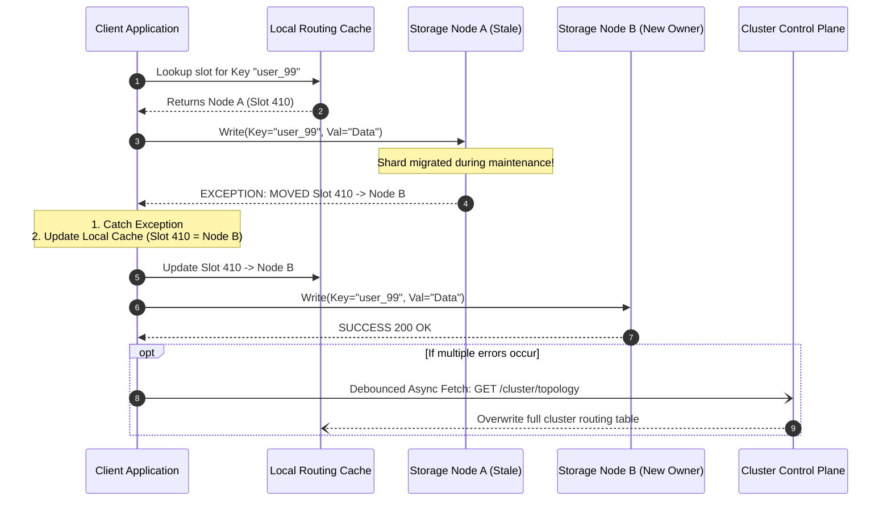

# Topology Refresh Pattern: Handling Stale Routing Exceptions in Sharded Systems

---

### 1. 💡 The "Big Picture" (Plain English)

#### What is this in simple terms?
In a large distributed system, data is chopped up and spread across dozens or hundreds of storage machines (shards). To read or write data quickly, your application keeps a local "cheat sheet" (a routing cache) of which machine owns which piece of data. 

However, machines crash, partitions split, and databases automatically rebalance data across new servers. When your app tries to talk to a server that no longer owns that data, the server rejects the request with a **Stale Routing Exception** (such as Redis's `MOVED`/`ASK` error or Kafka's `NotLeaderOrFollowerException`). The **Topology Refresh Pattern** is the resilience strategy client applications use to catch these exceptions, update their local cheat sheet, and redirect in-flight traffic without dropping user requests or overloading the cluster.

#### Real-World Analogy
Imagine visiting a multi-specialty clinic. Last month, your dermatologist was in **Room 204**. 
* You walk straight to **Room 204**, knock on the door, but a nurse opens it and says: *"Dr. Smith moved permanently to Room 412 this morning"* (this is your `MOVED` exception).
* What do you do? You don't throw your hands up, cancel your appointment, and go home (failing the request). 
* You also don't scream and force the 100 people in the waiting room to re-register at the front desk (a metadata thundering herd).
* Instead, you cross out "204" on your appointment card, write "412", walk over to Room 412, and get treated. If you find several doctors in the wrong rooms, you calmly stop by the central directory board to get a fresh map of the entire clinic.

#### Why should I care? What problem does it solve for me today?
Without this pattern, any cluster maintenance, autoscaling event, or leader re-election triggers a wave of unhandled errors for your users. Worse, naive retry logic causes a **Metadata Stampede**: thousands of microservice instances receive errors simultaneously and slam the cluster's coordination plane (like ZooKeeper, KRaft, or Redis master nodes) to reload the routing map, bringing the entire system to its knees.

---

### 2. 🛠️ How it Works (Step-by-Step)

#### The Process Flow
1. **Optimistic Dispatch**: The client looks up the key's partition in its local cache and dispatches the command directly to the assumed owner node.
2. **Exception Interception**: If the shard migrated, the target node rejects the command with a routing exception containing the new destination: `MOVED <new_slot> <node_ip:port>`.
3. **Targeted Cache Patch**: The client updates the specific key/slot mapping in its local cache immediately so subsequent calls go to the right node.
4. **Transparent Re-dispatch**: The client transparently redirects the failed request to the new node, hiding the glitch from the end user.
5. **Debounced Global Topology Refresh**: If the client encounters multiple routing errors within a short window, it flags its entire routing table as stale and schedules a background refresh of the full cluster map. This refresh is **debounced** (coalesced) so only one network call is made to the cluster, no matter how many threads failed.

#### Code Implementation (Java-style client handler)

```java
public class ResilientClusterClient {
    private final ConcurrentMap<Integer, NodeEndpoint> routingTable = new ConcurrentHashMap<>();
    private final AtomicBoolean isRefreshingTopology = new AtomicBoolean(false);
    private final ClusterMetadataService metadataService;

    public ResilientClusterClient(ClusterMetadataService metadataService) {
        this.metadataService = metadataService;
        refreshFullTopology();
    }

    public Response execute(Command command) {
        int slot = HashUtil.getSlot(command.getKey());
        int attempts = 0;
        final int MAX_ATTEMPTS = 3;

        while (attempts < MAX_ATTEMPTS) {
            attempts++;
            NodeEndpoint targetNode = routingTable.get(slot);

            try {
                // 1. Optimistic dispatch
                return targetNode.send(command);

            } catch (MovedRoutingException ex) {
                // 2. Node moved: extract the target from the exception (e.g., "MOVED 3999 10.0.0.15:6379")
                NodeEndpoint correctNode = new NodeEndpoint(ex.getTargetHost(), ex.getTargetPort());
                
                // 3. Patch the individual slot mapping locally
                routingTable.put(slot, correctNode);

                // 4. Trigger an asynchronous, debounced full refresh if the cluster is reshuffling
                scheduleDebouncedTopologyRefresh();

                // Loop will retry against the updated 'targetNode'

            } catch (AskRoutingException ex) {
                // Ephemeral redirect (slot is mid-migration): send an ASKING hand-shake first
                NodeEndpoint interimNode = new NodeEndpoint(ex.getTargetHost(), ex.getTargetPort());
                return interimNode.sendAsking(command);

            } catch (NodeUnreachableException ex) {
                // Physical failure: our cache is completely invalid
                scheduleDebouncedTopologyRefresh();
                throw ex;
            }
        }
        throw new ClusterExecutionException("Exhausted redirect attempts for key: " + command.getKey());
    }

    private void scheduleDebouncedTopologyRefresh() {
        // Guarantee only ONE thread performs the heavy cluster-wide metadata fetch
        if (isRefreshingTopology.compareAndSet(false, true)) {
            CompletableFuture.runAsync(() -> {
                try {
                    Map<Integer, NodeEndpoint> freshMap = metadataService.fetchClusterSlots();
                    routingTable.putAll(freshMap);
                } finally {
                    isRefreshingTopology.set(false);
                }
            });
        }
    }
}
```

#### Request Flow Architecture



---

### 3. 🧠 The "Deep Dive" (For the Interview)

#### The Internal Mechanics: Transient vs. Permanent Redirection
Distributed storage layers (like Redis Cluster, Apache Kafka, or CockroachDB) categorize topology mutations into two distinct phases: **In-Transit** and **Completed**. Your exception handler must differentiate between them:

1. **Permanent Migration (`MOVED` in Redis, `NOT_LEADER_OR_FOLLOWER` in Kafka):**
   * The ownership handoff is committed in the consensus group or cluster state.
   * *Strategy:* Mutate the client’s local routing table immediately. Re-dispatch the request to the new node.
2. **Transient Migration (`ASK` in Redis, `SplitInProgressException` in modern NewSQL):**
   * The slot is actively transferring from Node A to Node B. Node A has already moved the requested key, but it still owns the remainder of the partition.
   * *Strategy:* **Do NOT update the local cache.** If you update your cache for the whole partition, future reads/writes for non-migrated keys in that same slot will fail. Instead, perform a one-time "tunneled" redirect: send an `ASKING` preface command to Node B, run the operation, and leave your routing cache pointing to Node A.

```
[Client Local Cache: Slot 500 -> Node A]

When encountering "ASK":
Client -------- (1) Write KeyX --------> Node A (Throws ASK Node B)
Client -------- (2) ASKING Flag --------> Node B (One-time bypass)
Client -------- (3) Write KeyX --------> Node B (Success!)
[Client Local Cache: Unchanged (Still points to Node A for Slot 500)]
```

#### Guarding Against the "Metadata Stampede" (Singleflight Coalescing)
When a primary partition fails or a massive rebalance begins, hundreds of concurrent threads in your application pool may encounter routing exceptions at the exact same millisecond.

If every thread sends a `CLUSTER SLOTS` or `METADATA` request to the coordinator:
* The control plane crashes due to thread starvation or CPU saturation.
* The application grinds to a halt while processing megabytes of duplicate topology JSON/binary payloads.

To solve this, senior engineers implement **Singleflight Coalescing** using atomic flags or mutexes (`compareAndSet` or Go's `singleflight.Group`). All threads that fail simultaneously register listeners on a single, shared background metadata promise. When that single request resolves, all threads are notified at once.

#### Trade-Off Analysis
| Approach | Pros | Cons / Gotchas |
| :--- | :--- | :--- |
| **Fat Client Routing** *(Local Cache + Exception Invalidation)* | Sub-millisecond latency; zero extra network hops during steady state. | High memory footprint for massive partition counts; complex client-side exception handling. |
| **Thin Client via Proxy** *(e.g., AWS Envoy, Twemproxy)* | Client is simple; zero cluster routing logic inside application code. | Adds a permanent network hop (p99 latency tax) and an extra layer of infrastructure to scale. |
| **Immediate Full Sync on Error** | Guarantees instant synchronization with cluster state. | High risk of Metadata Stampede; can bring down cluster metadata coordinators under failover conditions. |

---

#### 💡 Interviewer Probes (How to Ace Them)

##### Probe 1: *"What happens if our client receives a `MOVED` redirect, connects to the new target node, and that node throws an exception saying the key belongs back on the first node?"*
* **The Candidate's Trap:** Saying "I will add a retry loop with exponential backoff until it resolves."
* **The Senior Answer:** "That indicates a **Routing Ping-Pong Loop** caused by an in-flight cluster split-brain or divergent cluster epoch metadata. If a client blindly retries, it will burn CPU and network cycles in an infinite loop. The solution is two-fold: First, enforce a strict `max_redirect_limit` (typically 3 to 5 hops). Second, compare the cluster **Epoch / Generation ID** returned in the exception headers. If the target node presents a lower or conflicting generation epoch than our current configuration, we abort the redirect, invalidate our local topology cache, and back off to allow the storage cluster's consensus layer to heal."

##### Probe 2: *"How do you handle in-flight non-idempotent writes (like `INCR` or appending to a list) when a Stale Routing Exception is thrown halfway through transmission?"*
* **The Candidate's Trap:** Assuming the redirect can simply be resent automatically.
* **The Senior Answer:** "We must determine whether the exception occurred *before* or *after* execution on the node. A routing exception like `MOVED` is returned synchronously *in place* of the command execution—meaning the node rejected the command during its parsing/routing phase and did not execute the write. It is therefore safe to redirect. 
However, if the connection dropped or timed out *during* the transition because the node stepped down mid-execution, we cannot assume it failed. In that case, we must rely on **client-assigned idempotency keys** or unique sequence IDs on the storage engine so the redirected write on the new leader can be safely deduplicated."

---

### 4. ✅ Summary Cheat Sheet

#### 3 Key Takeaways
1. **Routing is Optimistic**: In sharded distributed systems, clients route based on cached assumptions and rely on *exceptions* as the control signal to learn about topology updates.
2. **Differentiate Permanent from In-Transit**: Treat permanent redirects (`MOVED`) by patching your routing cache; treat ephemeral redirects (`ASK`) as isolated single-request hops without corrupting the partition map.
3. **Throttle the Metadata Plane**: Never let every thread fetch cluster maps independently. Always use atomic debouncing or Request Coalescing (Singleflight) to avoid taking down cluster coordinators during failovers.

#### 1 Golden Rule to Remember
> *"Route optimistically, handle relocation exceptions explicitly, and never allow an application thread pool to turn a partition move into a metadata stampede."*