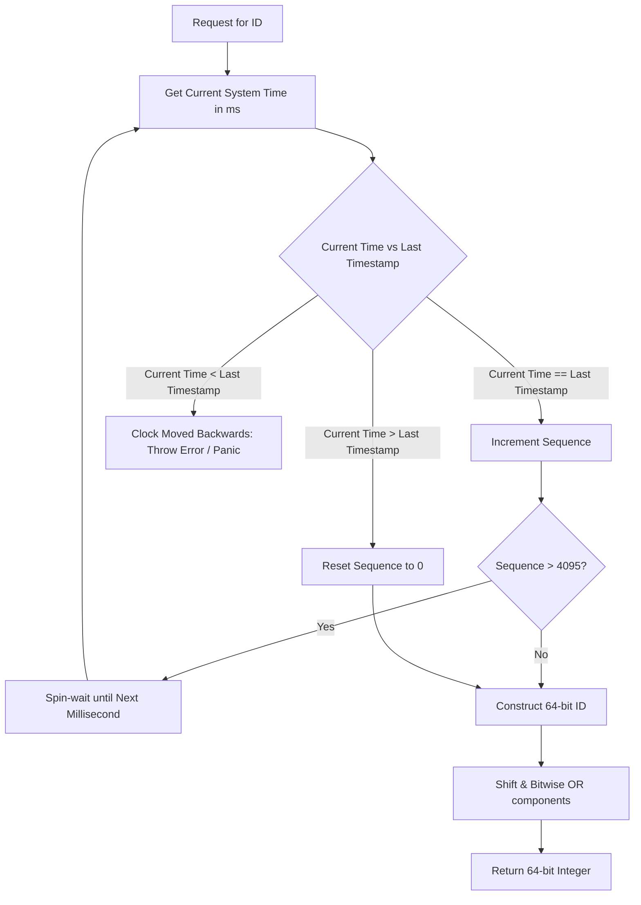

# Decentralized Monotonic Identifiers: Designing a Production-Grade Snowflake Generator

---

### 1. 💡 The "Big Picture" (Plain English)

#### What is this in simple terms?
A **Snowflake ID** is a 64-bit integer that gives every record in a massive, multi-server database a globally unique identifier—**without** the servers needing to talk to one another or check in with a central authority.

#### The Real-World Analogy
Imagine a massive airport with 30 security checkpoints. If every checkpoint agent had to shout to a single manager across the terminal to ask, *"What's the next passenger number?"*, the line would grind to a halt.

Instead, the airport hands each agent a custom mechanical stamp:
* The first part of the stamp prints the **current minute**.
* The middle part prints the **checkpoint desk number** (Desk #12).
* The last part is a **counter** on the stamp that clicks up by 1 with each passenger.

Now, all 30 agents can stamp thousands of boarding passes per minute independently. No communication, no delays, zero duplicate numbers, and tickets naturally stay in chronological order.

#### Why should I care?
* **Auto-incrementing DB IDs (`AUTO_INCREMENT`) don't scale:** They require a single database node to act as the source of truth, creating a bottleneck and a Single Point of Failure (SPOF).
* **UUIDs (v4) hurt performance:** 128-bit random strings are twice as large, cannot be naturally sorted by time, and randomly scatter your data across disk pages, causing catastrophic **B-Tree index fragmentation** at scale.
* **Snowflake gives you the sweet spot:** A compact, 64-bit integer that is roughly time-sortable, highly performant, and generated with zero network overhead.

---

### 2. 🛠️ How it Works (Step-by-Step)

A Snowflake ID packs time, machine identity, and a local counter into a single 64-bit binary integer.

```
+--------------------------------------------------------------------------+
| 1 Bit |    41 Bits     |      10 Bits      |          12 Bits            |
| Sign  | Epoch Millis   | Worker / Node ID  | Local Sequence Counter      |
+--------------------------------------------------------------------------+
```

1. **Sign Bit (1 bit):** Always set to `0` to keep the integer positive in signed systems (like Java's `long`).
2. **Timestamp (41 bits):** Milliseconds elapsed since a custom starting epoch (e.g., when your company launched). $2^{41}$ milliseconds gives you **~69.7 years** of runway.
3. **Worker/Node ID (10 bits):** Identifies the specific machine or container. $2^{10}$ gives you **1,024 unique worker nodes**.
4. **Sequence Number (12 bits):** A local counter that increments for every ID generated within the same millisecond on that specific node. $2^{12}$ allows **4,096 IDs per millisecond per node** (~4.09 million IDs/sec per node).

#### System Flowchart



#### Production-Grade Implementation (Java)

```java
public class SnowflakeIdGenerator {
    // Structural Bit Allocations
    private static final long WORKER_ID_BITS = 10L;
    private static final long SEQUENCE_BITS = 12L;

    // Bit Masks and Max Values
    private static final long MAX_WORKER_ID = ~(-1L << WORKER_ID_BITS); // 1023
    private static final long MAX_SEQUENCE = ~(-1L << SEQUENCE_BITS);   // 4095

    // Bit Shifts
    private static final long WORKER_ID_SHIFT = SEQUENCE_BITS;
    private static final long TIMESTAMP_LEFT_SHIFT = SEQUENCE_BITS + WORKER_ID_BITS;

    // Custom Epoch: 2024-01-01 00:00:00 UTC (1704067200000L)
    private final long customEpoch;
    private final long workerId;

    private long sequence = 0L;
    private long lastTimestamp = -1L;

    public SnowflakeIdGenerator(long workerId, long customEpoch) {
        if (workerId < 0 || workerId > MAX_WORKER_ID) {
            throw new IllegalArgumentException("Worker ID out of range [0, " + MAX_WORKER_ID + "]");
        }
        this.workerId = workerId;
        this.customEpoch = customEpoch;
    }

    public synchronized long nextId() {
        long currentTimestamp = getCurrentTimeMillis();

        // 1. Detect Clock Drift (Skew)
        if (currentTimestamp < lastTimestamp) {
            long drift = lastTimestamp - currentTimestamp;
            throw new IllegalStateException("Clock moved backwards! Refusing to generate ID for " + drift + "ms");
        }

        // 2. Sequence Handling within the same millisecond
        if (currentTimestamp == lastTimestamp) {
            sequence = (sequence + 1) & MAX_SEQUENCE;
            if (sequence == 0) {
                // Buffer exhausted: wait for the next millisecond
                currentTimestamp = waitNextMillis(currentTimestamp);
            }
        } else {
            // New millisecond: reset sequence counter
            sequence = 0L;
        }

        lastTimestamp = currentTimestamp;

        // 3. Assemble components using Bitwise Shifts and OR
        return ((currentTimestamp - customEpoch) << TIMESTAMP_LEFT_SHIFT)
                | (workerId << WORKER_ID_SHIFT)
                | sequence;
    }

    private long waitNextMillis(long currentTimestamp) {
        while (currentTimestamp <= lastTimestamp) {
            currentTimestamp = getCurrentTimeMillis();
        }
        return currentTimestamp;
    }

    protected long getCurrentTimeMillis() {
        return System.currentTimeMillis();
    }
}
```

---

### 3. 🧠 The "Deep Dive" (For the Interview)

#### Architectural Internals & Performance
* **B-Tree Optimization:** Because the leading 41 bits represent a monotonically increasing timestamp, records inserted into database tables with a Snowflake primary key are appended to the right-hand side of a B-Tree index. This eliminates expensive B-Tree node splits and random page re-balancing common with UUIDv4.
* **Bitwise Shift Arithmetic:** Building the ID uses only raw CPU register bitwise shifts (`<<`) and bitwise OR (`|`) operations, completing in sub-nanosecond hardware cycles. The locking mechanism (`synchronized` or atomic spinlocks) is generally the only bottleneck.

#### Trade-offs & Limitations
| Advantage | Trade-off |
| :--- | :--- |
| **Space-Efficient (64 bits):** Half the size of UUIDs, native fit for database indices. | **Information Leakage:** The ID exposes creation timestamp and worker ID. Never use them as public-facing, guessable URLs for sensitive resources (e.g., invoices). |
| **Locally Independent:** Zero network calls or database locks to mint an ID. | **Roughly Sortable, Not Strictly Linear:** IDs from two different nodes in the same millisecond may interleave. It gives *causal* ordering within a node, but not global linearizability across nodes. |
| **Deterministic Scale:** Easily supports up to 1,024 nodes out of the box. | **Hard Lifetime Cap:** Once the 41-bit timestamp reaches $2^{41} - 1$ milliseconds (~69 years), the timestamp overflows into the sign bit. |

---

#### Interviewer Probe Questions

#### Probe 1: *"What happens if NTP adjusts the server clock backward by 50 milliseconds?"*
* **The Trap:** Claiming that `System.currentTimeMillis()` is always monotonic. It is not; NTP servers can step the system clock backwards during time synchronization.
* **Production Answer:** 
  1. *Small Drift (< 5ms):* Spin-wait in a loop until the clock catches up with `lastTimestamp`.
  2. *Large Drift (> 5ms):* Reject the request and fail fast with an error, or log an alert and refuse requests until time catches up.
  3. *Zero-downtime approach:* Reserve a fallback pool of Worker IDs. If the clock jumps backwards, immediately swap to a "backup" Worker ID space to prevent collision while running in the past.

#### Probe 2: *"How do you provision the 10-bit Worker IDs automatically without static configuration files?"*
* **The Trap:** Suggesting you manually configure `workerId=1, 2, 3...` across 500 Docker containers.
* **Production Answer:**
  * **Kubernetes:** Use a `StatefulSet`. It gives pods predictable ordinal indexes (`pod-0`, `pod-1`, etc.). Pass the ordinal as an environment variable to set the `workerId`.
  * **Dynamic (Consul / ZooKeeper / Etcd):** On application startup, the node creates an ephemeral sequential znode or registers a key-value lease (e.g., `/workers/node-0000000042`). The allocated sequence number modulo 1,024 becomes the worker ID. If the node dies, the lease expires and frees the ID for new pods.

#### Probe 3: *"What if traffic on a single node spikes beyond 4,096 IDs in less than 1 millisecond?"*
* **The Trap:** Letting the sequence bit overflow silently into the Worker ID bit.
* **Production Answer:** The mask `(sequence + 1) & MAX_SEQUENCE` catches this. When the counter hits 4,096, it wraps to `0`. We detect this condition and force the thread to spin-wait (or yield with `Thread.onSpinWait()`) until the system clock advances to the next millisecond, resetting the limit for the next cycle.

---

### 4. ✅ Summary Cheat Sheet

* **3 Key Takeaways:**
  1. **Structure Matters:** 1 bit (sign) + 41 bits (time) + 10 bits (node) + 12 bits (counter) = 64 bits of uncoordinated, collision-free identity.
  2. **Index-Friendly:** Because the timestamp is at the most significant bits, writes naturally append sequentially to database B-Trees, preserving storage performance.
  3. **Vulnerabilities:** Susceptible to NTP clock skew (backward jumps) and needs a clear strategy for Worker ID provisioning in dynamic cloud environments.

* **1 Golden Rule to Remember:**
  > *"Snowflake trades cross-cluster strict ordering for local autonomy: you get massive write concurrency and index efficiency at the cost of slight time interleaving across nodes."*