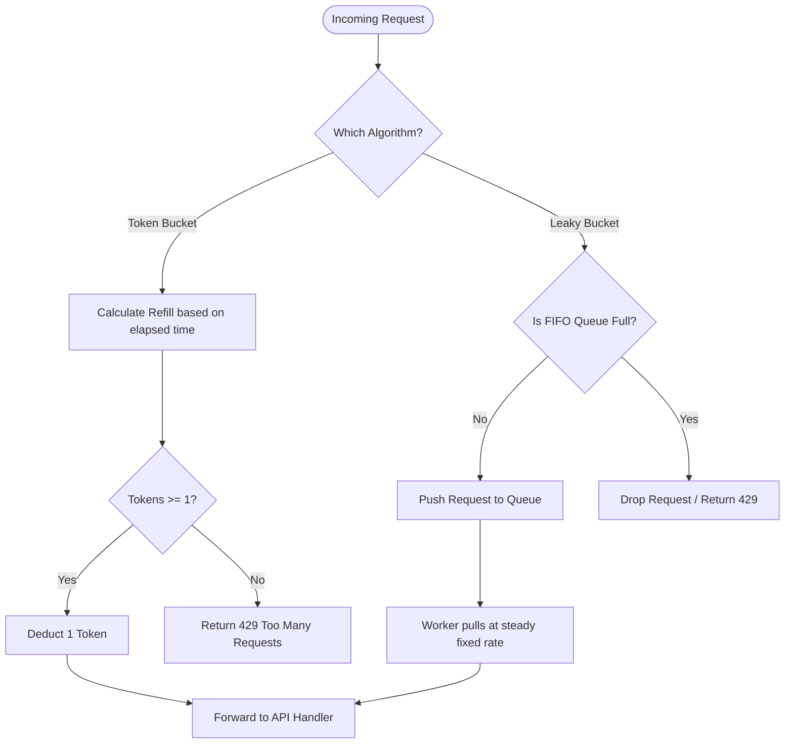

# API Traffic Shaping: Token Bucket vs. Leaky Bucket in Distributed Systems

---

### 1. 💡 The "Big Picture" (Plain English)

Imagine you run an exclusive nightclub with a strict fire code:

*   **The Token Bucket** is like handing out entry vouchers. A bouncer drops one voucher into a bowl every second, up to a maximum capacity of 10 vouchers. If a group of 5 friends shows up after the bowl has been sitting full, all 5 get vouchers and walk right in together—that’s a **burst**. But once the bowl is empty, everyone must wait outside until new vouchers drop.
*   **The Leaky Bucket** is a revolving door that turns at one fixed speed—say, exactly one rotation every two seconds. Even if 50 people sprint to the door at once, only one person gets through every two seconds. The line forms behind the door. If the sidewalk runs out of room, newcomers are turned away immediately.

```
Token Bucket (Bursty Output)          Leaky Bucket (Smoothed Output)
Tokens arrive at fixed rate            Traffic arrives in bursts
      │                                     │  │  │  │
   ▼──┴──▼                               ▼──┴──┴──┴──▼
  [•••••••] (Bucket holds tokens)       \             / (Queue holds reqs)
     │                                   \ • • • • • /
     ▼                                    \___   ___/
Allows sudden bursts of traffic               │
if enough tokens exist.                       ▼ Fixed, smooth drip
```

#### Why Care?
Without rate limiting:
1.  **A single rogue client** (or a DDoS attack) can flood your API and starve every other user.
2.  **Downstream databases crash** because they cannot handle sudden 10x traffic spikes.
3.  **Your cloud bills skyrocket** when pay-per-call third-party APIs (like OpenAI or Twilio) get hammered.

---

### 2. 🛠️ How it Works (Step-by-Step)

#### Algorithm Breakdown

| Step | Token Bucket | Leaky Bucket |
| :--- | :--- | :--- |
| **1. Inflow** | Tokens are added at a steady rate ($r$ per second) up to capacity ($C$). | Requests arrive at arbitrary times and enter a FIFO queue of size $C$. |
| **2. Storage** | Holds *tokens* (not actual requests). | Holds *actual requests* waiting to be processed. |
| **3. Execution** | Request arrives: takes a token and executes **immediately**. | Requests leak out of the queue at a constant, fixed rate ($r$). |
| **4. Overflow** | If no tokens exist, request is rejected (`429 Too Many Requests`). | If queue is full, new incoming requests are dropped or rejected. |

#### Production-Ready Implementation: Lazy-Refill Token Bucket

A common junior mistake is creating a background thread with `setInterval()` or `sleep()` to add tokens every second. In production with millions of users, running millions of background timers will destroy your memory and CPU.

Instead, we compute tokens **lazily** upon request arrival:

```python
import time

class TokenBucket:
    def __init__(self, capacity: int, refill_rate: float):
        """
        :param capacity: Maximum number of tokens the bucket can hold.
        :param refill_rate: Tokens added per second.
        """
        self.capacity = float(capacity)
        self.refill_rate = float(refill_rate)
        self.tokens = float(capacity)
        self.last_refill_timestamp = time.time()

    def allow_request(self, tokens_requested: int = 1) -> bool:
        now = time.time()
        elapsed = now - self.last_refill_timestamp
        self.last_refill_timestamp = now

        # Lazily calculate newly generated tokens based on elapsed time
        self.tokens = min(self.capacity, self.tokens + (elapsed * self.refill_rate))

        # Check if we have enough tokens to serve the request
        if self.tokens >= tokens_requested:
            self.tokens -= tokens_requested
            return True
        
        return False

# Usage
limiter = TokenBucket(capacity=5, refill_rate=1.0) # 5 max burst, 1 token/sec

# Simulate 3 immediate requests
print(limiter.allow_request())  # True (4 tokens left)
print(limiter.allow_request())  # True (3 tokens left)
print(limiter.allow_request())  # True (2 tokens left)
```

#### Decision Flow



---

### 3. 🧠 The "Deep Dive" (For the Interview)

#### The Concurrency Trap in Distributed Systems
In a real interview, you won’t be asked to write this for a single thread. You’ll be asked: *"How does this work across 10 API instances behind an AWS ALB?"*

If you store token counts in Redis using simple `GET` and `SET` commands, you create a classic **Race Condition (Check-Then-Act)**:

1. Request A reads `tokens = 1` from Redis.
2. Request B reads `tokens = 1` from Redis simultaneously.
3. Both subtract 1 and set `tokens = 0`.
4. Two requests pass through when only one should have.

**The Fix:** Run the lazy-refill logic inside an **atomic Redis Lua script**. Redis executes Lua scripts as a single atomic unit, blocking other scripts until it finishes, eliminating race conditions without distributed locks.

```lua
-- Atomic Token Bucket in Redis Lua
local key = KEYS[1]
local capacity = tonumber(ARGV[1])
local refill_rate = tonumber(ARGV[2])
local requested = tonumber(ARGV[3])
local now = tonumber(ARGV[4])

local data = redis.call("HMGET", key, "tokens", "last_updated")
local tokens = tonumber(data[1])
local last_updated = tonumber(data[2])

if not tokens then
    tokens = capacity
    last_updated = now
else
    local elapsed = math.max(0, now - last_updated)
    tokens = math.min(capacity, tokens + (elapsed * refill_rate))
end

if tokens >= requested then
    tokens = tokens - requested
    redis.call("HMSET", key, "tokens", tokens, "last_updated", now)
    redis.call("EXPIRE", key, math.ceil(capacity / refill_rate))
    return 1 -- Allowed
else
    redis.call("HMSET", key, "tokens", tokens, "last_updated", now)
    return 0 -- Rejected
end
```

#### Architectural Trade-offs

| Dimension | Token Bucket | Leaky Bucket |
| :--- | :--- | :--- |
| **Burst Handling** | **Excellent.** Can immediately consume the entire bucket for bursty user traffic. | **Poor.** Enforces strict pacing; bursts are forced to wait in the queue. |
| **Downstream Protection** | **Risky.** A sudden spike up to bucket capacity can overwhelm fragile legacy DBs. | **Maximum.** Output is deterministic, flat, and guaranteed never to exceed $R$ req/sec. |
| **Memory Footprint** | **Minimal.** Only stores two numbers per client: `last_refill_timestamp` and `tokens`. | **Higher.** Must allocate a physical buffer/queue to hold pending request payloads. |
| **Latency Profile** | **Near-zero added latency.** Request either executes instantly or is rejected. | **Variable latency.** Requests queued during spikes suffer high queueing delays. |

---

### 🎤 Interviewer Probes: How to Win the Follow-Up

#### Probe 1: *"If Token Bucket allows bursts, aren't we still exposing our downstream service to being overwhelmed?"*
> **Candidate Answer:** *"Yes, if the bucket capacity is set too high. To solve this, production systems often use a **two-tiered approach**: an outer Token Bucket at the API Gateway to accommodate bursty user traffic (e.g., page refreshes), paired with an inner Leaky Bucket in front of sensitive backend services (like payment processors or legacy SQL databases) to convert those bursts into a flat, smooth ingestion stream."*

#### Probe 2: *"What happens when Redis becomes the bottleneck for our rate limiter at 500,000 RPS?"*
> **Candidate Answer:** *"Querying Redis on every single HTTP request adds network hops and saturates Redis CPU. We can optimize using **local memory token batching**: each API server requests a batch of tokens (e.g., 50 tokens at a time) from Redis via atomic decrement, tracks them locally in RAM, and only syncs back when its local allotment is exhausted. If an instance crashes, we only waste a small batch of tokens, keeping our global limit mostly accurate while drastically cutting Redis IOPS."*

#### Probe 3: *"How do you handle a client whose connection drops while their request is queued in a Leaky Bucket?"*
> **Candidate Answer:** *"This causes wasted work. To mitigate this, queue items must include a **TTL/deadline timestamp**. Before the downstream worker processes an item popped from the queue, it checks whether `now > deadline` or if the client disconnected (via HTTP context cancellation). If expired, the worker discards the request immediately without calling downstream systems."*

---

### 4. ✅ Summary Cheat Sheet

*   **Token Bucket = Burst Tolerant:** Accepts bursts up to capacity; discards requests only when tokens hit zero. Ideal for user-facing APIs.
*   **Leaky Bucket = Traffic Smoothing:** Eliminates bursts completely; outputs requests at a strictly constant rate. Ideal for protecting fragile backends.
*   **Lazy Refill Pattern:** Never run timers for each client. Calculate token accrual mathematically on arrival using `(current_time - last_time) * refill_rate`.

> **The Golden Rule:** Use **Token Bucket** when you care about client responsiveness and can tolerate spikes; use **Leaky Bucket** when downstream stability is your highest priority and spikes are strictly forbidden.