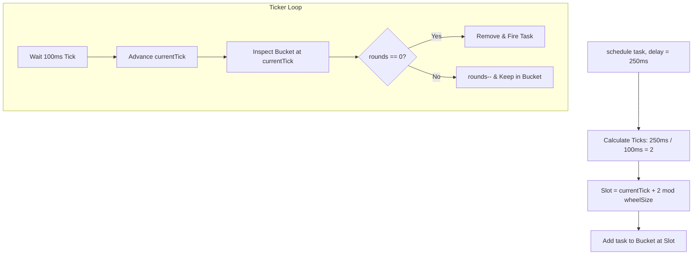

# The Hashed Timing Wheel: Mastering O(1) Scalable Timer Collections

---

### 1. 💡 The "Big Picture" (Plain English)

#### What is this in simple terms?
A **Hashed Timing Wheel** is a specialized, time-indexed collection designed to store and fire future tasks (like connection timeouts, retries, and cache expirations) in constant time $O(1)$. Instead of continuously sorting upcoming deadlines, it acts like a round clock face divided into fixed time intervals (ticks). When the "hand" of the clock arrives at a tick, it executes all tasks waiting in that slot.

#### Real-World Analogy: The Restaurant Carousel
Imagine an analog 60-second wall clock with sticky notes pinned to its perimeter. 
* If a customer orders french fries that take 10 seconds to cook, the chef sticks a note 10 seconds ahead of the second hand.
* If another order takes 70 seconds, the chef places the note on the 10-second mark, but writes **"Round 1"** on it.
* Every second, the hand ticks forward. The chef only checks the notes attached to the exact second the hand just landed on. They fry whatever is due for "Round 0", and subtract a round from anything tagged for future laps. 

The chef never sorts a pile of hundreds of receipts; they only ever look at the exact slot under the hand.

#### Why should I care? What problem does it solve today?
Standard collections for scheduling—like Java’s `DelayQueue` or `ScheduledThreadPoolExecutor`—use a **Binary Min-Heap**. 
* Inserting a task into a heap is $O(\log N)$. 
* Canceling or removing a task is $O(N)$ or $O(\log N)$.

When you have **1,000,000 active web socket connections** and every connection needs a 30-second heartbeat or idle timeout, a heap collapses under the weight of reshuffling millions of nodes every second. The Hashed Timing Wheel drops task scheduling, task cancellation, and task execution to **$O(1)$ amortized time**, making it the engine behind high-throughput networking frameworks like **Netty, Kafka, and the Linux kernel**.

---

### 2. 🛠️ How it Works (Step-by-Step)

#### The Step-by-Step Mechanics
1. **Initialize the Wheel:** Create a fixed-size circular array of buckets (e.g., 64 buckets), where each bucket represents a duration known as `tickDuration` (e.g., 100 milliseconds).
2. **Calculate the Destination:** When adding a task with delay $D$:
   * Total ticks required = $D / \text{tickDuration}$.
   * Destination index = $(\text{currentTickIndex} + \text{ticks}) \pmod{\text{wheelLength}}$.
   * Remaining rounds = $\text{ticks} / \text{wheelLength}$.
3. **Store in Bucket:** Append the task to a doubly-linked list residing at that index.
4. **Advance the Clock:** At every tick interval, the pointer advances by 1. It scans only that bucket's linked list:
   * If a task has `remainingRounds == 0`, remove it and execute it.
   * If `remainingRounds > 0`, decrement `remainingRounds--` and leave it for the next lap.

```
       [Slot 0] ---> [Task A (Rounds: 0)] <-> [Task B (Rounds: 2)]
      /        \
 [Slot 7]     [Slot 1]
    |             |
 [Slot 6]     [Slot 2] <--- [HAND / CURRENT TICK]
      \        /
       [Slot 4]
```

#### Code Implementation (Clean Java)

```java
import java.util.function.Consumer;

public class SimpleHashedWheelTimer {
    
    // Node representing an individual delayed task
    public static class TimerTask {
        private final Runnable action;
        private final long delayMs;
        private long remainingRounds;
        private TimerTask next, prev;
        private boolean cancelled = false;

        public TimerTask(Runnable action, long delayMs) {
            this.action = action;
            this.delayMs = delayMs;
        }

        public void cancel() {
            this.cancelled = true;
        }
    }

    // A bucket holding a doubly-linked list of tasks
    private static class Bucket {
        private TimerTask head, tail;

        void addTask(TimerTask task) {
            if (head == null) {
                head = tail = task;
            } else {
                tail.next = task;
                task.prev = tail;
                tail = task;
            }
        }

        void removeTask(TimerTask task) {
            if (task.prev != null) task.prev.next = task.next;
            if (task.next != null) task.next.prev = task.prev;
            if (task == head) head = task.next;
            if (task == tail) tail = task.prev;
            task.next = task.prev = null;
        }

        void expireTasks() {
            TimerTask current = head;
            while (current != null) {
                TimerTask next = current.next;
                if (current.cancelled) {
                    removeTask(current);
                } else if (current.remainingRounds <= 0) {
                    removeTask(current);
                    current.action.run(); // Run expired task
                } else {
                    current.remainingRounds--; // Survived this lap
                }
                current = next;
            }
        }
    }

    private final Bucket[] wheel;
    private final int mask; // For fast bitwise modulo if power of 2
    private final long tickDurationMs;
    private int currentTick = 0;

    public SimpleHashedWheelTimer(int ticksPerWheel, long tickDurationMs) {
        // Enforce power of two for bitwise wrapping
        int capacity = 1;
        while (capacity < ticksPerWheel) capacity <<= 1;
        
        this.wheel = new Bucket[capacity];
        for (int i = 0; i < capacity; i++) {
            this.wheel[i] = new Bucket();
        }
        this.mask = capacity - 1;
        this.tickDurationMs = tickDurationMs;
    }

    /**
     * O(1) scheduling of future work
     */
    public synchronized TimerTask schedule(Runnable action, long delayMs) {
        long ticks = delayMs / tickDurationMs;
        long rounds = ticks / wheel.length;
        
        int destinationSlot = (int) ((currentTick + ticks) & mask);
        
        TimerTask task = new TimerTask(action, delayMs);
        task.remainingRounds = rounds;
        
        wheel[destinationSlot].addTask(task);
        return task;
    }

    /**
     * Called by an external background thread/loop at tickDurationMs intervals
     */
    public synchronized void onTick() {
        Bucket bucket = wheel[currentTick];
        bucket.expireTasks();
        currentTick = (currentTick + 1) & mask;
    }
}
```

#### Process Flow Diagram



---

### 3. 🧠 The "Deep Dive" (For the Interview)

#### Architectural Internals & Performance Secrets

1. **Power-of-Two Masking over Modulo Arithmetic:**
   Real-world production implementations (such as Netty’s `HashedWheelTimer`) always round bucket array capacities to a power of two. This replaces the expensive CPU division operation (`% wheel.length`) with an ultrafast bitwise AND (`& (wheel.length - 1)`).

2. **The "Rounds" Overhead vs. Hierarchical Timing Wheels:**
   * In a **Simple Hashed Wheel**, tasks with very large timeouts sit in buckets with high `remainingRounds`. If millions of tasks with 24-hour delays end up in the wheel, the tick thread wastes CPU cycles iterating through linked lists decrementing `rounds--` without actually running anything.
   * To achieve true scalability, systems use **Hierarchical Timing Wheels** (like George Varghese and Anthony Lauck's classic paper, adopted by Kafka). It mirrors a car odometer: a "Seconds Wheel" cascades into a "Minutes Wheel", which cascades into an "Hours Wheel". Long-term tasks sit idle in higher-tier wheels and are migrated (*re-bucketed*) to lower-tier wheels only when their expiration horizon enters that wheel's window.

3. **Lock Contention Mitigations (MPSC Queues):**
   A naive synchronized timing wheel creates lock contention when thousands of threads schedule timeouts simultaneously. Production designs make task scheduling **lock-free** by pushing new tasks into a high-speed lock-free `MpscQueue` (Multi-Producer, Single-Consumer). Only the dedicated **Worker Thread** drains this queue and places tasks into the actual wheel buckets on its next tick.

#### Trade-offs & Limitations

| Feature | Advantage | Trade-off |
| :--- | :--- | :--- |
| **Hashed Wheel** | Amortized $O(1)$ inserts, cancellations, and fires. | **Quantization Error:** Deadlines are rounded to the nearest tick (not down to the nanosecond). |
| **Binary Min-Heap** | Exact temporal precision; memory footprint scales strictly with element count. | Rescheduling is $O(\log N)$; unacceptable lock contention at $10^5+$ tasks. |
| **Hierarchical Wheel** | Eliminates round-scanning; supports massive time spans. | Memory complexity increases with multiple layers; cascading tasks adds occasional CPU spikes. |

#### Interviewer Probes (Tricky Scenarios)

##### Probe 1: "What happens if a scheduled task takes 5 seconds to run inside the tick thread?"
**Answer:** The entire timing wheel blocks, causing massive **clock drift** and delayed execution of subsequent slots. The timing wheel’s worker loop must **never** execute user business logic directly on the ticking thread. Instead, it must immediately offload execution to an external worker pool (e.g., an `ExecutorService`) or complete a `CompletableFuture`, allowing the ticking thread to instantly advance to the next slot.

##### Probe 2: "Under what specific workload does a Hashed Timing Wheel perform worse than a standard Min-Heap `DelayQueue`?"
**Answer:** 
1. **Extremely sparse workloads:** If you have only 5 tasks scheduled over the next week, the timing wheel thread will wake up thousands of times every second just to inspect empty buckets, burning CPU cycles unnecessarily. A `DelayQueue` parks its thread efficiently using `LockSupport.parkNanos()` until the exact timestamp of the earliest task.
2. **Nanosecond precision needs:** If tasks require microsecond-accurate firing, the wheel would require nanosecond tick resolutions, which causes CPU churn and scheduler throttling.

##### Probe 3: "How do you achieve $O(1)$ task cancellation without scanning the bucket?"
**Answer:** The `schedule()` method must return an opaque `Timeout` handle containing the node reference. Because each bucket is a **Doubly-Linked List**, the task node maintains pointers to its `prev` and `next` siblings. The caller invokes `handle.cancel()`, which either sets a `volatile boolean cancelled = true` (marking it for lazy removal on the next tick) or uses atomic pointer updates to detach the node immediately in $O(1)$ without searching the list.

---

### 4. ✅ Summary Cheat Sheet

#### 3 Key Takeaways
1. **Choose over Heaps for Volume:** Use Hashed Timing Wheels when managing $\ge 100,000$ active, dynamic timers (e.g., connection keep-alives, write timeouts) where $O(\log N)$ heap updates choke the CPU.
2. **Accept Quantization:** You are trading temporal precision for throughput. A 100ms tick resolution means actions fire within $[T, T + 100\text{ms}]$.
3. **Decouple Ticking from Running:** The thread advancing the wheel must strictly manage pointers and offload task execution to prevent clock drift.

#### 1 Golden Rule to Remember
> **"If tasks are rare and require exact timestamps, use a Heap; if tasks are abundant and approximate delays are fine, use a Timing Wheel."**