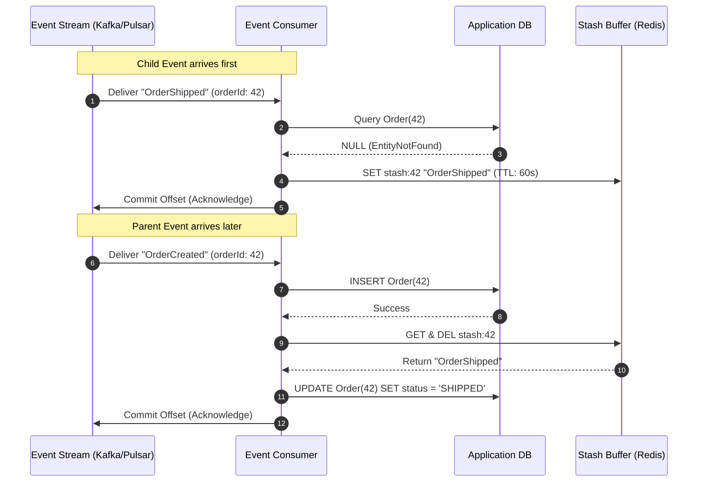

# Out-of-Order Event Stashing: Handling Missing Predecessor Exceptions in Distributed Streams

---

### 1. 💡 The "Big Picture" (Plain English)

#### What is this in simple terms?
In distributed event-driven systems, network latencies, retries, and concurrent processing pipelines mean messages frequently arrive out of chronological order. When a downstream consumer receives a child event (e.g., `PaymentCaptured` or `OrderShipped`) before the parent event (e.g., `OrderCreated`), the consumer cannot find the parent record in its database and throws a `MissingPredecessorException` or `EntityNotFoundException`. 

Instead of crashing the consumer, stalling the queue, or immediately discarding the message into a Dead Letter Queue (DLQ), **Event Stashing** catches this exception, diverts the out-of-order message into a temporary, short-lived holding store ("parking lot"), and automatically plays it back the moment its predecessor arrives.

```
       [ Upstream Events ]
          │          │
          │ (Fast)   │ (Delayed by network retry)
          ▼          ▼
    OrderShipped  OrderCreated
          │
          ▼
   Consumer Service
          │
          ├─► DB lookup fails: "Order not found!"
          │
          └─► STASH in Holding Buffer (Don't crash, don't DLQ)
```

#### Real-World Analogy
Imagine you order a flat-pack bed frame and a mattress online. They ship separately. 
The delivery driver bringing the mattress arrives at your house on Monday. If the driver refuses to drop off the mattress and throws it straight into the municipal incinerator (the Dead Letter Queue) just because the bed frame hasn't arrived yet, that would be absurd. 

Instead, the driver drops the mattress in your garage (the **Stash Buffer**). On Tuesday, the bed frame arrives and you assemble it. You then walk into the garage, grab the mattress, and put it on the bed. Everything resolves smoothly without customer service escalation.

#### Why should I care? What problem does it solve for me today?
* **Eliminates False-Alarm DLQs:** Up to 70% of messages dumped into DLQs in high-throughput event architectures are not corrupt data; they are completely valid messages that simply arrived a few hundred milliseconds too early.
* **Prevents Head-of-Line Blocking:** If you halt your Kafka or message queue partition until the parent message appears, you block thousands of unrelated tenant messages behind it, killing system throughput.
* **Maintains Autonomy Without Distributed Locks:** It allows asynchronous microservices to maintain eventual consistency without coordinating via heavyweight distributed locks across service boundaries.

---

### 2. 🛠️ How it Works (Step-by-Step)

#### The Execution Lifecycle

1. **Ingest & Attempt:** The consumer reads an event (`ChildEvent`) and attempts to apply the business transition against the local read-model or database.
2. **Trap Missing Predecessor:** If the target entity does not exist, the consumer catches `EntityNotFoundException`.
3. **Park with TTL:** The consumer serializes the `ChildEvent` into an ephemeral key-value store (e.g., Redis) keyed by the expected parent ID (e.g., `stash:order:12345`), decorated with an expiration TTL (Time-To-Live).
4. **Acknowledge Message:** The consumer acknowledges (commits) the message offset on the main queue to keep partition processing moving.
5. **Wake-up Trigger:** When the predecessor (`ParentEvent`) finally arrives and is successfully written to the database, its transaction completion hook fires a lookup for any stashed keys matching that parent ID.
6. **Drain & Apply:** If stashed events exist, they are fetched, applied in sequence within the context of the newly established parent state, and removed from the stash.

#### Mermaid Flow



#### Production-Ready Implementation (TypeScript / Node.js)

```typescript
import { Redis } from "ioredis";

interface DomainEvent {
  eventId: string;
  aggregateId: string;
  eventType: "ORDER_CREATED" | "ORDER_SHIPPED";
  payload: Record<string, unknown>;
}

export class OrderEventConsumer {
  private db: Map<string, any> = new Map(); // Simulated database
  private stashClient: Redis;
  private readonly STASH_TTL_SECONDS = 60;

  constructor(redisClient: Redis) {
    this.stashClient = redisClient;
  }

  /**
   * Main dispatcher for consuming incoming streaming events.
   */
  public async onMessage(event: DomainEvent): Promise<void> {
    try {
      switch (event.eventType) {
        case "ORDER_CREATED":
          await this.handleOrderCreated(event);
          break;
        case "ORDER_SHIPPED":
          await this.handleOrderShipped(event);
          break;
        default:
          console.warn(`Unhandled event type: ${event.eventType}`);
      }
    } catch (error) {
      if (error instanceof MissingPredecessorException) {
        // Intercept: Do not throw or DLQ. Park the event instead.
        await this.stashOrphanedEvent(event);
      } else {
        // Genuine fatal or transient error -> escalate to standard retry/DLQ pipeline
        throw error;
      }
    }
  }

  private async handleOrderShipped(event: DomainEvent): Promise<void> {
    const order = this.db.get(event.aggregateId);

    if (!order) {
      // The predecessor (ORDER_CREATED) has not been processed yet!
      throw new MissingPredecessorException(
        `Order ${event.aggregateId} not found for shipment application.`
      );
    }

    // Happy Path: Entity exists, apply state change
    order.status = "SHIPPED";
    order.shippedAt = event.payload.shippedAt;
    this.db.set(event.aggregateId, order);
    console.log(`[Success] Applied ORDER_SHIPPED for order ${event.aggregateId}`);
  }

  private async handleOrderCreated(event: DomainEvent): Promise<void> {
    // 1. Persist the primary entity
    const newOrder = {
      id: event.aggregateId,
      status: "CREATED",
      createdAt: event.payload.createdAt,
    };
    this.db.set(event.aggregateId, newOrder);
    console.log(`[Success] Created Order ${event.aggregateId}`);

    // 2. Post-Commit Hook: Check if any children were stashed waiting for this parent
    await this.drainStashedEvents(event.aggregateId);
  }

  private async stashOrphanedEvent(event: DomainEvent): Promise<void> {
    const stashKey = `stash:${event.aggregateId}`;
    const payload = JSON.stringify(event);

    // Stash in a Redis list with a dead-man TTL to avoid memory leaks
    await this.stashClient
      .multi()
      .rpush(stashKey, payload)
      .expire(stashKey, this.STASH_TTL_SECONDS)
      .exec();

    console.warn(
      `[Stashed] Missing parent for event ${event.eventType} (${event.aggregateId}). Parked in Redis.`
    );
  }

  private async drainStashedEvents(aggregateId: string): Promise<void> {
    const stashKey = `stash:${aggregateId}`;

    // Atomically retrieve and clear all parked events for this entity
    const stashedRawEvents = await this.stashClient.lrange(stashKey, 0, -1);
    if (!stashedRawEvents || stashedRawEvents.length === 0) {
      return;
    }

    await this.stashClient.del(stashKey);
    console.log(`[Drain] Replaying ${stashedRawEvents.length} stashed events for ${aggregateId}`);

    for (const raw of stashedRawEvents) {
      const stashedEvent: DomainEvent = JSON.parse(raw);
      // Re-dispatch recursively now that the parent state exists
      await this.onMessage(stashedEvent);
    }
  }
}

export class MissingPredecessorException extends Error {
  constructor(message: string) {
    super(message);
    this.name = "MissingPredecessorException";
  }
}
```

---

### 3. 🧠 The "Deep Dive" (For the Interview)

#### The Internal Mechanics
Under the hood, out-of-order handling forces an architectural trade-off between **causal ordering** (Event A caused Event B, therefore A must precede B) and **temporal ordering** (Event B arrived at wall-clock time $T_2$, which was before Event A arrived at $T_3$). 

1. **Atomic Drain Concurrency (The Race Window):**
   A critical edge case occurs when `OrderCreated` and `OrderShipped` are processed on **two separate consumer instances simultaneously**. 
   * Thread 1 receives `OrderShipped`, checks the DB, finds nothing.
   * Thread 2 receives `OrderCreated`, commits to the DB, checks the stash, finds nothing, and finishes.
   * Thread 1 now pushes `OrderShipped` to the stash.
   * *Result:* The stashed event is now a permanent orphan.
   * *Solution:* To prevent this, systems must implement **Optimistic Concurrency Control (OCC)** on the aggregate root or execute the "Stash Insertion" using a Redis Lua script that checks whether the parent was written into the primary database in the interim before finalizing the stash.

2. **The "Tombstone / Lost Predecessor" Escalation:**
   What if the parent message was permanently dropped upstream or routed to an unmonitored poison queue?
   If an event sits in the Stash Buffer and its TTL expires, the storage system must emit an eviction event (e.g., Redis Keyspace Notifications via `expired` events, or a secondary sweeper job). This eviction worker catches the orphaned child and escalates it to a true **Permanent Failure DLQ** for human investigation, complete with an enriched metadata tag: `REASON: PREDECESSOR_NEVER_ARRIVED`.

#### Architecture Trade-Offs

| Approach | Latency | Storage Overhead | Complexity | Risk Profile |
| :--- | :--- | :--- | :--- | :--- |
| **Partition-Key Affinity Only** | Ultra-Low | None | Very Low | Breaks down if events span different topics/aggregates. |
| **Naive DLQ Routing** | Low | High (Operational) | Low | High false-positive alerts; requires constant manual redrives. |
| **Event Stashing (This Pattern)** | Minimal (~1-5ms) | Low (Ephemeral RAM) | Moderate | Requires handling drain-vs-stash race conditions. |

---

### Interviewer Probes: Tricky Questions & Strong Responses

#### 🎙️ Probe 1: "Why not just pause the Kafka consumer partition and wait until the missing event arrives?"
> **Weak Answer:** "Pausing works, but it's hard to write the code for pausing and resuming."
>
> **Strong Answer:** "Pausing a partition introduces catastrophic **Head-of-Line (HoL) blocking**. If Partition 3 holds events for thousands of different customers, pausing that partition because Customer #1234's `OrderCreated` is 500ms late blocks Customer #5678, #9101, and all other unrelated tenants on that partition. Stashing de-correlates individual causal chains from stream transport partitions, allowing the stream to proceed at wire speed while isolating latency penalties exclusively to the affected aggregate."

#### 🎙️ Probe 2: "What happens if three events for the same aggregate arrive in reverse order: Event 3, then Event 2, then Event 1?"
> **Weak Answer:** "The stash handles it because it keeps the events in Redis."
>
> **Strong Answer:** "A flat list stash can fail here if we don't track causality. If Event 3 and Event 2 are stashed, and Event 1 arrives, blindly replaying the stash in FIFO order might apply Event 3 before Event 2. To solve this, stashed messages must carry **monotonic sequence numbers or vector clocks**. In our buffer, we use a Redis Sorted Set (ZSET) where the score is the domain version/sequence number (`expectedVersion`). When the parent commits, we drain the ZSET in ascending score order, ensuring deterministic causal reconstitution."

#### 🎙️ Probe 3: "Isn't stashing an anti-pattern? Shouldn't we design our domain model so that operations are fully commutative?"
> **Weak Answer:** "Yes, we should always make operations commutative instead."
>
> **Strong Answer:** "Commutativity (e.g., using CRDTs or idempotent upserts where $f(A, B) = f(B, A)$) is the theoretical gold standard, but it often clashes with real-world business constraints. For example, you cannot physically or legally capture funds against a payment authorization or dispatch an inventory reservation against a non-existent customer billing address. Where business rules enforce strict causal dependencies, commutativity cannot be achieved at the state level; stashing provides a resilient, localized safety net to reconcile that causal reality."

---

### 4. ✅ Summary Cheat Sheet

#### 3 Key Takeaways
1. **Out-of-order errors are transient timing discrepancies, not fatal poison pills.** Treating them as application exceptions that immediately route to a DLQ leads to alert fatigue and unneeded operational overhead.
2. **Decouple transport from business causality.** Keep your partition offsets advancing by delegating out-of-order state reconciliation to an ephemeral key-value buffer.
3. **Always attach a dead-man TTL to stashed payloads.** Every stashed event must have a short TTL that fails over to a secondary Dead Letter pipeline to guarantee that permanently orphaned children are never silently dropped in memory.

#### 1 Golden Rule to Remember
> *"If an event fails because its target does not exist yet, park it; do not discard it. The network didn't corrupt your data—it just scrambled your clocks."*