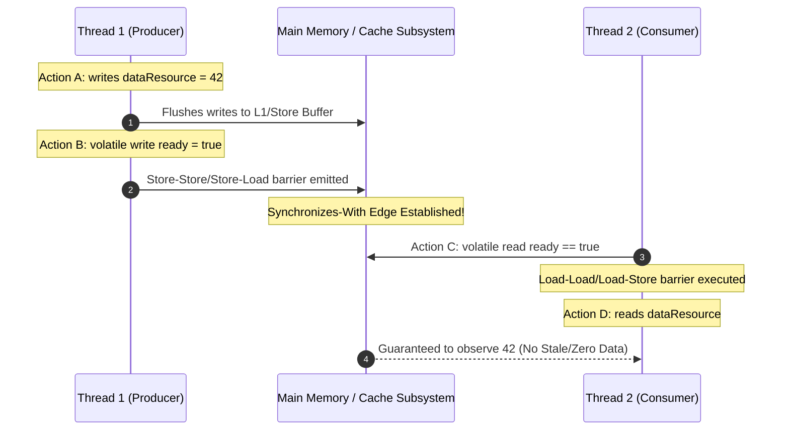

# JVM Memory Model: Happens-Before Hierarchy, Synchronizes-With Edges, and DRF-SC Guarantees

---

### 1. 💡 The "Big Picture" (Plain English)

#### What is this in simple terms?
The Java Memory Model (JMM) is **not** about where objects live in physical RAM (like Heap vs. Stack). It is the legal contract between the Java Virtual Machine (JVM), the JIT compiler, the CPU, and your code. It answers one vital question: 

> *"When Thread A writes a value to a variable, under what exact conditions is Thread B guaranteed to see that write?"*

Without this contract, modern multi-core processors and optimizing compilers would scramble your code's execution order to squeeze out performance, causing threads to read phantom or stale values.

#### The Real-World Analogy
Imagine a busy restaurant kitchen with two chefs: Chef A (Salad station) and Chef B (Plating station). 

* Chef A prepares a salad and writes notes on their **personal notepad** (a CPU register / L1 cache).
* Chef B needs that salad to finalize the dish, but Chef B is looking at the **central order board** (Main Memory).
* Even if Chef A finished the salad 10 seconds ago in real-time, Chef B has no idea it exists until Chef A walks over, posts the ticket to the central board, and dings the order bell.

The **ding of the bell** is a formal handoff. In the JMM, this handoff is called a **Happens-Before edge**. Without that bell, Chef B might assemble the plate with missing ingredients, or pick up a dressing that Chef A hasn’t even finished mixing yet.

#### Why Should I Care?
Compilers and CPUs aggressively reorder instructions. They delay memory writes into hardware **Store Buffers** and pull stale data from **L1/L2 caches**. 

If you write multithreaded code without understanding the JMM:
* Your code might pass all unit tests on your x86 Intel/AMD development laptop (which has strong hardware memory guarantees).
* The exact same code will fail catastrophically and intermittently in production when deployed to ARM64 servers (like AWS Graviton or Apple Silicon) because ARM allows aggressive memory reordering that x86 forbids.

---

### 2. 🛠️ How it Works (Step-by-Step)

The JMM establishes order through a formal mathematical relation called **Happens-Before ($hb$)**. If action $X$ *happens-before* action $Y$ ($X \xrightarrow{hb} Y$), the memory changes made by $X$ are guaranteed to be visible to $Y$, and $X$ will appear to have executed before $Y$.

```
[Thread 1]                 [Thread 2]
Action A (Data Write)
   │ (Program Order)
   ▼
Action B (Volatile Write) ─── Synchronizes-With ───► Action C (Volatile Read)
                                                           │ (Program Order)
                                                           ▼
                                                     Action D (Data Read sees Action A)
```

#### The Rules That Build Happens-Before:
1. **Program Order Rule:** Each action in a single thread *happens-before* every action that comes after it in that same thread's source code.
2. **Synchronizes-With Rule (The Bridge):** 
   * An unlock on a monitor *synchronizes-with* every subsequent lock on that same monitor.
   * A write to a `volatile` variable *synchronizes-with* every subsequent read of that same variable.
   * Calling `Thread.start()` *synchronizes-with* the first action in the started thread.
   * The termination of a thread *synchronizes-with* any thread detecting it via `Thread.join()` or `Thread.isAlive()`.
3. **Transitivity:** If $A \xrightarrow{hb} B$ and $B \xrightarrow{hb} C$, then $A \xrightarrow{hb} C$.

#### The Code: Constructing a Safe Publication Pipeline

```java
public class MemoryOrderHandoff {
    private int dataResource = 0;       // Regular, non-volatile variable
    private volatile boolean ready = false; // Volatile guard flag

    // Executed by Thread 1: Producer
    public void produce() {
        // Step 1: Plain write to regular memory
        dataResource = 42; 

        // Step 2: Volatile write (Release semantics)
        // By Program Order: (dataResource = 42) happens-before (ready = true)
        ready = true; 
    }

    // Executed by Thread 2: Consumer
    public void consume() {
        // Step 3: Volatile read (Acquire semantics)
        // If ready is true, Thread 1's write "synchronizes-with" this read!
        if (ready) { 
            // Step 4: Transitivity kicks in:
            // (dataResource = 42) -> hb -> (ready = true) -> sw -> (ready == true) -> hb -> (use dataResource)
            // GUARANTEED: dataResource will NEVER be observed as 0 here.
            System.out.println("Result: " + dataResource);
        }
    }
}
```

#### Sequence Flow Diagram



---

### 3. 🧠 The "Deep Dive" (For the Interview)

#### 1. The Core Paradox: Happens-Before $\neq$ Execution Order
This is the single most common misconception: **Happens-before does NOT mean "happened earlier in real-time."**

The JVM and modern CPUs are allowed to reorder instructions **as long as the result is indistinguishable from an execution where the happens-before order was strictly respected**.

```java
int a = 1; // Action A
int b = 2; // Action B
```
By the Program Order Rule, $A \xrightarrow{hb} B$. However, because $A$ and $b$ do not depend on each other, the JIT compiler and CPU can freely execute $B$ before $A$ in physical clock cycles. The JMM only cares about **coherence and visibility**, not physical wall-clock timing.

#### 2. The DRF-SC Guarantee (Data-Race-Free Sequential Consistency)
The crown jewel of the JSR-133 specification is the **DRF-SC Theorem**:
> *If your program has no data races, all executions of your program will appear to be **Sequentially Consistent (SC)**.*

* **Sequential Consistency (The Ideal World):** Operations occur in a single, globally visible step-by-step order, and every thread sees all operations in that exact same order.
* **Data Race (The Bug):** A data race occurs when:
  1. Two or more threads concurrently access the same memory location.
  2. At least one of the accesses is a write.
  3. The accesses are **not** ordered by a happens-before relationship.

If you have even **one** data race, the DRF-SC guarantee is void. The JVM is no longer required to provide sequential consistency, and bizarre reordering behaviors are permitted.

#### 3. Out-Of-Thin-Air (OOTA) Safety
Even when a program contains a data race, the JMM guarantees **Type Safety** and **Out-Of-Thin-Air (OOTA) Safety**. A thread can read a stale value, but it cannot read a completely arbitrary 32-bit or 64-bit value that was never written by *some* thread in the program.

To prevent OOTA values, the JMM formal specification defines **Causality Cycles**.
* *Causality Loop Example:* 
  * Thread 1: `r1 = x; y = r1;`
  * Thread 2: `r2 = y; x = r2;`
  * Initially `x = 0; y = 0;`
* If a speculative compiler guessed `x = 42`, Thread 1 would read `42` and write `y = 42`. Thread 2 would read `y = 42` and write `x = 42`. The speculation would justify itself!
* The JMM specifically prohibits such self-justifying speculative writes through complex mathematical causality requirements.

#### Architectural Trade-offs: Hardware Architectures vs. JMM Fences

| Architecture | Memory Model Strength | Hardware Cost of a `volatile` write |
| :--- | :--- | :--- |
| **x86 / AMD64** | **Strong (TSO - Total Store Order)**. Reads are never reordered with reads, writes are never reordered with writes. Only Store-Load reordering is allowed. | Low. Emits a simple `lock addl` or `mfence` instruction to flush the Store Buffer. |
| **ARM64 / Apple Silicon** | **Weak**. Reads and writes can be reordered in almost any combination (Load-Load, Load-Store, Store-Store, Store-Load). | Higher. Emits full memory barriers (e.g., `dmb ish` / `ldar` / `stlr`) to force CPU cores to coordinate pipeline state. |

---

### Interviewer Probes: Tricky Questions & How to Answer

#### Probe 1: "If Thread 1 executes an action at 12:00:00.000 and Thread 2 reads that variable at 12:00:00.005, is Thread 2 guaranteed to see the change because it happened later in time?"
* **The Candidate Trap:** Saying "Yes, because it happened 5 milliseconds later."
* **The Senior Answer:** "No. Physical wall-clock time has no meaning in the Java Memory Model. Unless there is a formal `synchronizes-with` edge (such as a volatile write/read, monitor unlock/lock, or thread join) connecting Thread 1's write to Thread 2's read, Thread 2 may pull stale data from its CPU core's L1/L2 cache indefinitely, regardless of elapsed time."

#### Probe 2: "Can a 64-bit `long` or `double` violate Out-Of-Thin-Air safety in standard Java?"
* **The Candidate Trap:** Answering "No, the JVM always guarantees safety."
* **The Senior Answer:** "Yes, on older 32-bit JVMs for non-volatile fields! According to JLS §17.7, writes to non-volatile `long` and `double` fields are treated as two separate 32-bit writes. If two threads write concurrently to the same 64-bit variable without synchronization, a reader thread can observe a 'torn write'—a composite value where the high 32 bits come from Thread 1 and the low 32 bits come from Thread 2. That resulting 64-bit value was literally never written by either thread. Declaring the field `volatile` or running on a 64-bit JVM eliminates word tearing."

#### Probe 3: "Why doesn't the JVM just make every variable sequentially consistent by default so developers don't have to deal with happens-before?"
* **The Candidate Trap:** Stating "It uses too much RAM."
* **The Senior Answer:** "It would cripple runtime performance. Sequential Consistency requires enforcing strict memory barriers on every single read and write. This disables major compiler optimizations such as register allocation, loop invariant code motion (hoisting), common subexpression elimination, and CPU-level optimizations like write-buffering and speculative branch execution. The JMM was intentionally designed with the DRF-SC model to allow 99% of single-threaded code to run at maximum hardware speed while providing synchronization primitives for thread interaction boundaries."

---

### 4. ✅ Summary Cheat Sheet

#### 3 Key Takeaways
1. **Happens-Before is about Visibility, not Timing:** An action having a happens-before relationship to another guarantees that the updates are *visible*, not that the hardware executed them earlier on the clock.
2. **Volatile provides Acquire/Release Semantics:** A volatile write acts as a *Release* (all previous writes are flushed and cannot be reordered below it). A volatile read acts as an *Acquire* (all subsequent reads cannot be reordered above it).
3. **No Race = Sequential Consistency:** If your program is free of data races (all shared mutable state is protected by a happens-before edge), the execution is guaranteed to behave as if instructions ran sequentially on a single interleaved timeline.

#### 1 Golden Rule to Remember
> **"Without a Synchronizes-With edge, cross-thread memory visibility does not exist—regardless of how much physical time has passed."**