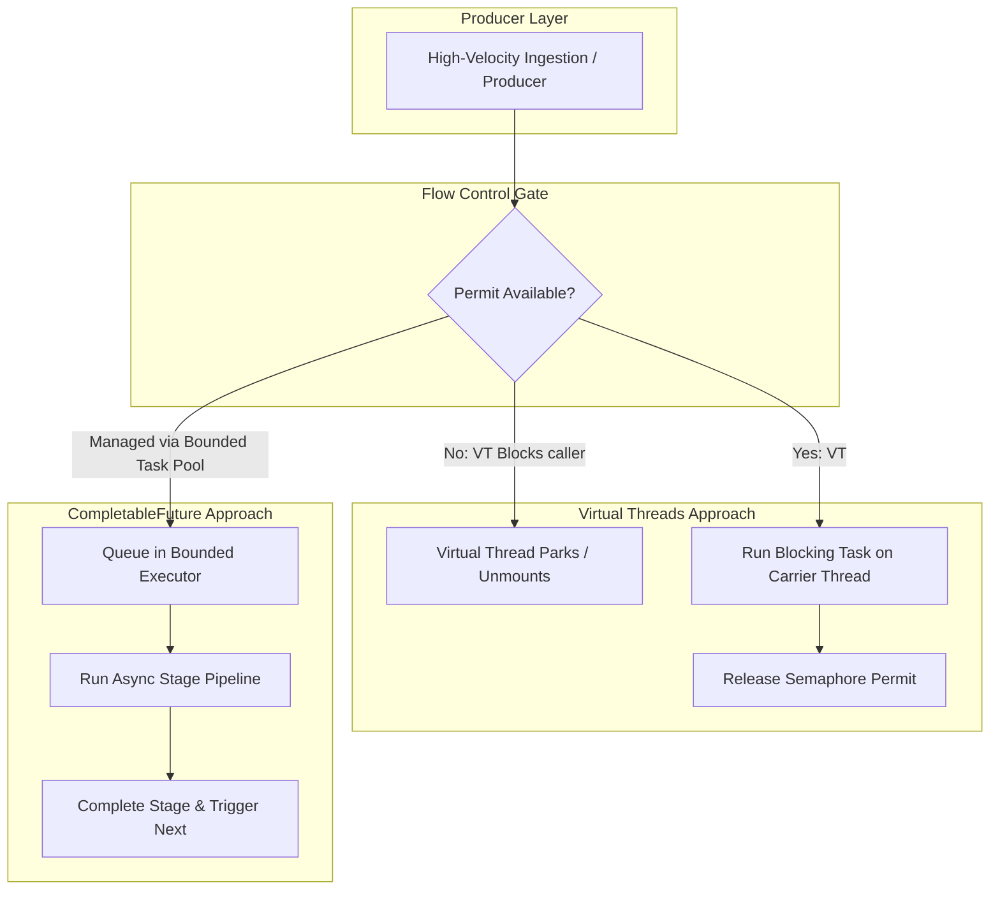

# Backpressure and Flow Control: Managing Ingestion Overload in Virtual Threads vs. CompletableFuture

---

### 1. 💡 The "Big Picture" (Plain English)

#### What is this in simple terms?
**Backpressure** is a system’s ability to say: *"Stop sending me work; I’m falling behind."* 

When a fast producer sends tasks to a slow consumer, those unprocessed tasks must wait somewhere. If you have no mechanism to slow down the producer, the waiting tasks pile up in memory until the application crashes with an `OutOfMemoryError` (OOM) or system latency spikes into complete unresponsiveness.

#### Real-World Analogy
Imagine an artisan coffee shop:
* **The Producer (Cashier):** Can take an order and swipe a credit card every 5 seconds.
* **The Consumer (Barista):** Takes 60 seconds to pull an espresso shot and steam milk.

If the cashier keeps taking orders non-stop, printed order tickets will cover the counter, spill onto the floor, and eventually bury the espresso machine. 

**Backpressure** is the barista telling the cashier: *"Hold the line. Do not take another order until there are fewer than 3 tickets on my board."* The line of customers outside the door now absorbs the wait, protecting the workspace from collapsing.

#### Why Should I Care?
* **CompletableFuture** is push-based and has **zero built-in backpressure**. If you fire off 500,000 asynchronous stages in a loop, you will flood the underlying `ForkJoinPool` queue, spike heap consumption, and degrade garbage collection.
* **Virtual Threads** allow you to spin up millions of threads cheaply, but **downstream resources (databases, memory, sockets) are still finite**. Spawning 1,000,000 virtual threads without flow control simply converts a thread exhaustion problem into a heap, socket, or database connection exhaustion problem.

Mastering flow control allows you to design systems that degrade gracefully under extreme load instead of crashing catastrophically.

---

### 2. 🛠️ How it Works (Step-by-Step)

Managing flow control differs drastically between these two models:

* **In CompletableFuture (Async/Push Model):** Because stages are event-driven, flow control must be enforced **before** scheduling the task using bounded queues or custom throttled executors.
* **In Virtual Threads (Sync/Pull Model):** Because blocking is practically free, flow control is implemented using traditional, synchronous coordination primitives like `Semaphore` or `ArrayBlockingQueue`. The producer naturally blocks without burning OS resources.

#### Architectural Flow



#### Code Implementation

Here is how to enforce clean flow control and prevent out-of-memory blowouts in both paradigms:

```java
import java.util.concurrent.*;

public class IngestionFlowControl {

    // =========================================================================
    // 1. VIRTUAL THREADS: Flow Control via Semantic Blocking (Semaphore)
    // =========================================================================
    public static class VirtualThreadThrottler implements AutoCloseable {
        private final ExecutorService executor = Executors.newVirtualThreadPerTaskExecutor();
        // Allow at most 50 concurrent active virtual tasks
        private final Semaphore semaphore;

        public VirtualThreadThrottler(int maxConcurrency) {
            this.semaphore = new Semaphore(maxConcurrency);
        }

        public void submitTask(Runnable task) throws InterruptedException {
            // BACKPRESSURE: If permits are exhausted, the calling thread blocks here.
            // If the caller is also a Virtual Thread, it simply unmounts from its carrier.
            semaphore.acquire();

            executor.submit(() -> {
                try {
                    task.run();
                } finally {
                    // Release the permit so the next task can proceed
                    semaphore.release();
                }
            });
        }

        @Override
        public void close() {
            executor.close();
        }
    }

    // =========================================================================
    // 2. COMPLETABLEFUTURE: Flow Control via Bounded Custom Executor
    // =========================================================================
    public static class CompletableFutureThrottler {
        private final ThreadPoolExecutor boundedExecutor;

        public CompletableFutureThrottler(int corePoolSize, int maxQueueCapacity) {
            this.boundedExecutor = new ThreadPoolExecutor(
                corePoolSize,
                corePoolSize,
                0L, TimeUnit.MILLISECONDS,
                new ArrayBlockingQueue<>(maxQueueCapacity),
                // BACKPRESSURE POLICY: When the queue is full, run the task 
                // in the calling thread, naturally slowing down ingestion!
                new ThreadPoolExecutor.CallerRunsPolicy()
            );
        }

        public CompletableFuture<String> processAsync(String payload) {
            return CompletableFuture.supplyAsync(() -> {
                // Heavy I/O or transformation simulation
                return "Processed: " + payload;
            }, boundedExecutor);
        }

        public void shutdown() {
            boundedExecutor.shutdown();
        }
    }
}
```

---

### 3. 🧠 The "Deep Dive" (For the Interview)

#### The Internal Mechanics

##### 1. CompletableFuture's Missing Backpressure Mechanics
`CompletableFuture` implements `Future<T>` and `CompletionStage<T>`. It is inherently an asynchronous, push-based dependency graph. 

When you attach downstream callbacks (`thenApplyAsync`, `thenComposeAsync`), each stage registers a completion record (e.g., `UniApply`, `UniCompose`) in a lock-free, Treiber-stack-style linked list on the parent future. 

If upstream produces results faster than downstream consumers can process them:
* The default `ForkJoinPool.commonPool()` works via an unbounded submission queue.
* `ForkJoinTask` objects and completion nodes accumulate on the Java heap.
* The JVM garbage collector suffers because these chains create complex reference paths across young and old generations.

To get backpressure in CompletableFuture, you **must abandon the default common pool** and route stages through a `ThreadPoolExecutor` with a bounded queue and a restrictive `RejectedExecutionHandler` (like `CallerRunsPolicy` or a custom back-off handler).

##### 2. Virtual Threads and the Return of Synchronous Backpressure
Reactive Streams (e.g., Project Reactor, RxJava) introduced the `Subscription.request(n)` contract specifically to solve backpressure without blocking OS threads. 

Virtual Threads change this calculus entirely:
* When a virtual thread calls `semaphore.acquire()` or `blockingQueue.put()`, and no slots are available, the runtime does not block the underlying OS (carrier) thread.
* The virtual thread executes a **continuation yield** (`Continuation.yield()`). Its stack frames are copied from the carrier thread's native stack onto the JVM heap, and the carrier thread is immediately freed to execute other work.
* Once a permit is released via `semaphore.release()`, the runtime marks the continuation as runnable, and the carrier thread’s `ForkJoinPool` reschedules it.

> **Result:** Backpressure can be written using simple, intuitive, sequential `try-finally` blocks and standard synchronization primitives without burning operating system resources or managing reactive micro-batches.

#### Trade-Offs

| Metric | CompletableFuture (Bounded Queue) | Virtual Threads (Semaphore/Queue) |
| :--- | :--- | :--- |
| **Programming Model** | Asynchronous, functional, callback-driven. | Synchronous, sequential, imperative. |
| **Failure Mode Under Load** | Rejection exceptions (`RejectedExecutionException`) or queue latency. | Contention on coordination primitives (e.g., `CAS` overhead on Semaphores). |
| **Stack Trace Usability** | Low: Traces are fragmented across thread handoffs. | High: Clean, unified stack traces preserved. |
| **Resource Overhead** | Low thread footprint, high closure/callback allocation on heap. | Small Continuation object on heap (~hundreds of bytes to a few KB). |

---

#### Interviewer Probes (Tricky Questions & How to Answer)

##### Probe 1: *"Reactive programming gave us explicit dynamic backpressure via `Subscription.request(n)`. If Virtual Threads make reactive programming obsolete, how do we handle dynamic backpressure without it?"*
**Candidate Answer:**  
> "Reactive streams used dynamic demand signaling because blocking an OS thread was too expensive. With Virtual Threads, synchronous blocking is cheap. We implement backpressure using bounded buffers like `ArrayBlockingQueue` or concurrency throttles like `Semaphore`. 
> 
> When the buffer is full, the producer virtual thread parks—meaning its continuation unmounts from the carrier thread. The carrier thread remains 100% available for other work. Once the consumer processes an item, the producer is unparked and resumed. We achieve the exact same flow control as Reactive Streams, but with standard imperative blocking semantics and readable stack traces."

##### Probe 2: *"What happens if you use `Semaphore` to limit concurrency inside Virtual Threads, versus using a bounded thread pool in a legacy platform-thread architecture?"*
**Candidate Answer:**  
> "In a legacy platform-thread architecture, using a thread pool to limit concurrency ties the *concurrency limit* directly to the *OS thread count*. If you set the pool to 50, you consume 50 OS thread stacks (~50MB of native memory) even if those threads are idle or waiting on I/O.
> 
> With Virtual Threads, we decouple concurrency limits from thread counts. We can spawn 10,000 virtual threads to represent 10,000 distinct business transactions, but use a single `Semaphore(50)` to restrict access to a sensitive downstream resource (like a database connection pool). The 9,950 waiting virtual threads unmount and live passively on the heap (costing only a few kilobytes each), while the underlying carrier threads continue executing unblocked workloads."

##### Probe 3: *"Can a `Semaphore` or `BlockingQueue` cause Carrier Thread Pinning in Java 21?"*
**Candidate Answer:**  
> "No. Carrier thread pinning only occurs when a virtual thread blocks inside a `synchronized` block/method (prior to improvements in later JDKs) or inside native code/JNI calls. 
> 
> The concurrency primitives in `java.util.concurrent` (like `ReentrantLock`, `Semaphore`, and `ArrayBlockingQueue`) are built on `AbstractQueuedSynchronizer` (AQS). AQS has been explicitly updated in the JVM to park and unpark virtual threads cleanly via `LockSupport.park()`, which safely unmounts the continuation without pinning the underlying carrier thread."

---

### 4. ✅ Summary Cheat Sheet

#### 3 Key Takeaways
1. **Concurrency $\neq$ Throughput:** Just because you *can* create 1,000,000 Virtual Threads or chain 1,000,000 `CompletableFuture` stages doesn't mean your downstream database or network link can survive it.
2. **CompletableFuture requires proactive queue bounding:** Unbounded submission to `CompletableFuture` or `ForkJoinPool.commonPool()` will lead to heap exhaustion under sustained spikes.
3. **Virtual Threads turn blocking into an architectural asset:** You don't need complex reactive math (`request(n)`) to achieve backpressure; a standard `java.util.concurrent.Semaphore` or `BlockingQueue` cleanly unmounts the virtual thread and yields the CPU.

#### 1 "Golden Rule"
> **"Virtual Threads make thread creation cheap, not resources. Never run an unbounded producer without a bounded gatekeeper."**