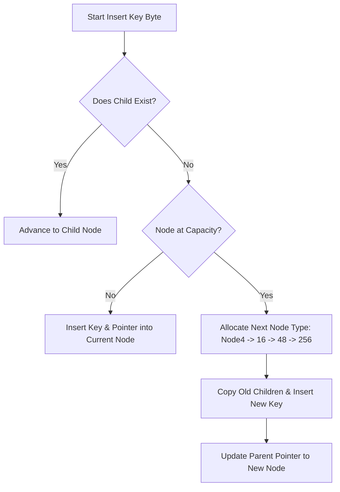

# The Adaptive Radix Tree (ART): Mastering Dynamic Node Compression & Cache-Conscious Indexing

---

### 1. 💡 The "Big Picture" (Plain English)

#### What is this in simple terms?
A standard Radix Tree (or Trie) is a search tree where each step down the tree represents a single character or byte of a key rather than comparing whole keys. 

However, traditional tries suffer from a brutal dilemma: 
* If every node allocates slots for all possible child characters (e.g., 256 slots for an 8-bit byte), you waste astronomical amounts of memory on empty `null` pointers.
* If every node only stores a dynamic linked list or hash map of children, you waste CPU time jumping across memory pointers just to find the next character.

The **Adaptive Radix Tree (ART)** solves this dilemma. An ART dynamically changes the size and structural layout of each node based on how many children that node actually holds. When a node has only 2 children, it uses a tiny footprint. If it grows to 200 children, it morphs into a fast direct-lookup table.

```
Traditional Trie (Fixed 256 pointers/node):
[ Node ] ---> 254 NULLs, 2 active pointers (Huge Memory Waste!)

Adaptive Radix Tree (ART):
[ Node4 ] ---> Holds exactly up to 4 children (Fits in a single CPU cache line!)
              Morphs to Node16 -> Node48 -> Node256 only when needed.
```

#### Real-World Analogy
Imagine an expanding document filing system in an office:
1. **Node4 (The Paper Sleeve):** When a client opens a file with only 2 or 3 documents, you store them in a cheap paper sleeve.
2. **Node16 (The Slim Binder):** As paperwork grows past 4 documents, you move the contents into a ring binder holding up to 16 sleeves.
3. **Node48 (The Hanging Drawer):** When documents exceed 16, you drop them into a file drawer with 48 numbered slots.
4. **Node256 (The Alphabetized Cabinet):** Only when the client has massive activity do you dedicate a 256-slot rolling cabinet where every letter/number has a permanent dedicated slot.

You never pay the spatial cost of a 256-slot cabinet for a client who only has 2 documents, but you never sacrifice the speed of direct access when you need it.

#### Why Should I Care?
Traditional balanced trees (like Red-Black Trees or $B$-Trees) scale their lookup time with the number of elements: $O(\log N)$. As your database grows to billions of rows, lookups get slower, and CPU cache misses compound because every key comparison requires reading data from distant memory locations.

ART’s lookup performance depends **only on the length of the key ($k$)**, yielding $O(k)$ time complexity, completely independent of how many millions of items are stored. It powers the ultra-fast indexing engines in modern in-memory databases like **DuckDB**, **HyPer**, and **SingleStore**.

---

### 2. 🛠️ How it Works (Step-by-Step)

ART uses four specialized internal node types based on child capacity:

1. **`Node4`**: Stores up to 4 keys and 4 child pointers. Keys and pointers are kept in small parallel arrays.
2. **`Node16`**: Stores up to 16 keys and 16 child pointers. Searching keys can be done via binary search or SIMD vector instructions.
3. **`Node48`**: Stores up to 48 child pointers, but uses a 256-byte lookup array. The character byte acts as an index into this 256-byte array, which yields an offset (0 to 47) into the actual child pointer array.
4. **`Node256`**: The classic trie node. A direct array of 256 pointers. The byte value itself directly indexes the child pointer array with no indirection.

#### Lifecycle of an Insertion:
1. **Deconstruct Key:** Break the key into an unsigned byte sequence (e.g., `"CAT"` $\to$ `[0x43, 0x41, 0x54]`).
2. **Traverse Byte-by-Byte:** At each node, look up the child matching the current byte.
3. **Detect Capacity:** If a matching branch does not exist, insert the new byte. If the current node is full (e.g., inserting a 5th child into a `Node4`), **morph** the node by allocating the next larger node type (`Node16`), copying existing entries over, and freeing or garbage-collecting the old node.



#### Clean Java Implementation (Adaptive Node Transitions)

```java
public class AdaptiveRadixTree {

    // Base interface for all node variants
    sealed interface ArtNode permits Node4, Node16, Node256, LeafNode {}

    // Terminal leaf holding the actual value
    record LeafNode(byte[] key, Object value) implements ArtNode {}

    // Node4: Holds up to 4 keys and 4 child references
    static final class Node4 implements ArtNode {
        byte[] keys = new byte[4];
        ArtNode[] children = new ArtNode[4];
        byte childCount = 0;

        ArtNode findChild(byte b) {
            for (int i = 0; i < childCount; i++) {
                if (keys[i] == b) return children[i];
            }
            return null;
        }

        ArtNode addChild(byte b, ArtNode child) {
            if (childCount < 4) {
                keys[childCount] = b;
                children[childCount] = child;
                childCount++;
                return this; // Still fits in Node4
            }
            // Capacity exceeded: Morph Node4 -> Node16
            Node16 expanded = new Node16();
            System.arraycopy(this.keys, 0, expanded.keys, 0, 4);
            System.arraycopy(this.children, 0, expanded.children, 0, 4);
            expanded.childCount = 4;
            return expanded.addChild(b, child);
        }
    }

    // Node16: Holds up to 16 keys and 16 children
    static final class Node16 implements ArtNode {
        byte[] keys = new byte[16];
        ArtNode[] children = new ArtNode[16];
        byte childCount = 0;

        ArtNode findChild(byte b) {
            // Linear scan or SIMD/binary search across up to 16 keys
            for (int i = 0; i < childCount; i++) {
                if (keys[i] == b) return children[i];
            }
            return null;
        }

        ArtNode addChild(byte b, ArtNode child) {
            if (childCount < 16) {
                keys[childCount] = b;
                children[childCount] = child;
                childCount++;
                return this;
            }
            // For brevity, morphing to Node48/Node256 follows this identical progression
            throw new UnsupportedOperationException("Expansion to Node48/256 triggered");
        }
    }

    // Node256: Direct array index lookup
    static final class Node256 implements ArtNode {
        ArtNode[] children = new ArtNode[256];

        ArtNode findChild(byte b) {
            return children[Byte.toUnsignedInt(b)];
        }

        void addChild(byte b, ArtNode child) {
            children[Byte.toUnsignedInt(b)] = child;
        }
    }
}
```

---

### 3. 🧠 The "Deep Dive" (For the Interview)

#### Architectural Internals & CPU Cache Alignment
1. **Cache-Line Fitting:**
   * A modern CPU cache line is **64 bytes**.
   * A `Node4` contains 4 byte keys (4 bytes) and 4 object references (32 bytes on 64-bit JVM without compressed OOPs, or 16 bytes with compressed OOPs). The entire node payload fits comfortably inside a **single L1 cache line**.
   * A `Node16` keys array (16 bytes) fits directly inside a single 128-bit SIMD register (SSE/AVX). A native or optimized runtime can evaluate child presence in **1 CPU cycle** using vector comparison instructions (e.g., `_mm_cmpeq_epi8`), eliminating CPU branch mispredictions entirely.

2. **The Node48 Indirection Layer:**
   * A naive jump from 16 to 256 children would waste 200+ pointer slots if a node only had 17 children. 
   * `Node48` solves this with an indirection array: `byte childIndex[256]` mapping to `ArtNode children[48]`.
   * Memory used: $256 \text{ bytes (indices)} + 48 \times 8 \text{ bytes (pointers)} \approx 640 \text{ bytes}$.
   * A `Node256` would take $256 \times 8 = 2048 \text{ bytes}$. `Node48` saves **~68% of the space** while maintaining $O(1)$ direct index lookups.

3. **Path Compression (Span Flattening):**
   * If a sequence of bytes has no branching (e.g., inserting `"INTERVIEW"` when no other keys share the prefix `"INTER"`), standard tries create 5 wasteful single-child nodes.
   * ART uses two techniques:
     * **Optimistic Path Compression:** Inner nodes hold a small fixed-size prefix array (e.g., up to 8 bytes) and an integer skip-length. Traversal skips comparison and verifies the prefix only once upon reaching the terminal leaf.
     * **Pessimistic Path Compression:** Inner nodes store the full non-branching prefix and validate every byte during descent.

#### Trade-offs & Engineering Realities

| Metric | Adaptive Radix Tree (ART) | Cache-Conscious $B^+$ Tree | Red-Black Tree (`TreeMap`) |
| :--- | :--- | :--- | :--- |
| **Lookup Time** | $O(k)$ (bounded by key byte-length) | $O(\log_B N)$ | $O(\log N)$ |
| **Comparisons** | Zero key comparisons (pure byte indexing) | Full key comparisons per node | Full key comparisons per node |
| **Memory Footprint** | Extremely low (dynamic node sizing) | Moderate (some internal node slack) | High (3 pointers + color per entry) |
| **Implementation Complexity** | **Very High** (4+ node schemas, morphing logic) | Medium-High | Medium |

#### Interviewer Probes (Tricky Edge Cases)

* **Probe 1: "How do you handle keys where one key is a prefix of another (e.g., `'app'` and `'apple'`) without corrupting tree traversal?"**
  * *Answer:* Standard ART requires all keys to be prefix-free. To support prefixes in general collections, you must use one of two designs:
    1. **Null-byte / Sentinel termination:** Keys are appended with a delimiter that cannot appear anywhere else in the dataset.
    2. **Compound Nodes:** Allow inner nodes to store an optional payload reference representing an exact key termination at that intermediate step, alongside their child pointer table.

* **Probe 2: "When deleting elements, how do you handle structural contraction?"**
  * *Answer:* Contraction is the inverse of node growth:
    * `Node256` shrinks to `Node48` when child count falls below 48.
    * `Node48` shrinks to `Node16` at 16 children.
    * `Node16` shrinks to `Node4` at 4 children.
    * `Node4` collapsing to a single child triggers **path compression**, collapsing the remaining child upward into the parent node to eliminate single-child chains.
    * *Practical caveat:* To prevent thrashing (repeatedly allocating/deallocating when rapidly inserting and deleting at boundary sizes), engines apply **hysteresis** (e.g., grow `Node4` $\to$ `Node16` at 5 children, but shrink `Node16` $\to$ `Node4` only when dropping to 3 children).

* **Probe 3: "How does concurrent modification work on ART without coarse-grained locking?"**
  * *Answer:* Modern implementations use **Optimistic Lock Coupling (OLC)** or **Read-Copy-Update (RCU)** semantics. Because a node morph (e.g., `Node4` to `Node16`) replaces an object reference, the writer builds the new node off-line, populates it, and swaps the parent's pointer using a single atomic compare-and-swap (CAS). Readers never block; they traverse optimistically and validate a node version tag to detect concurrent node morphs.

---

### 4. ✅ Summary Cheat Sheet

#### 3 Key Takeaways
1. **Dynamic Polymorphism for Memory:** ART avoids standard trie memory waste by mutating through 4 node architectures (`Node4`, `Node16`, `Node48`, `Node256`) as child density changes.
2. **Key-Length Bounded:** Lookups scale with key length $O(k)$, not element count $O(\log N)$. Searching a billion 64-bit integers takes at most 8 pointer hops.
3. **Hardware-Sympathetic:** Small nodes (`Node4`/`Node16`) leverage CPU cache lines and SIMD registers for lightning-fast scanning without key-comparison branch misses.

#### 1 Golden Rule to Remember
> *"Use a $B^+$ Tree when your data lives primarily on disk or block storage; use an **Adaptive Radix Tree** when your index lives entirely in RAM and CPU cache misses are your primary bottleneck."*